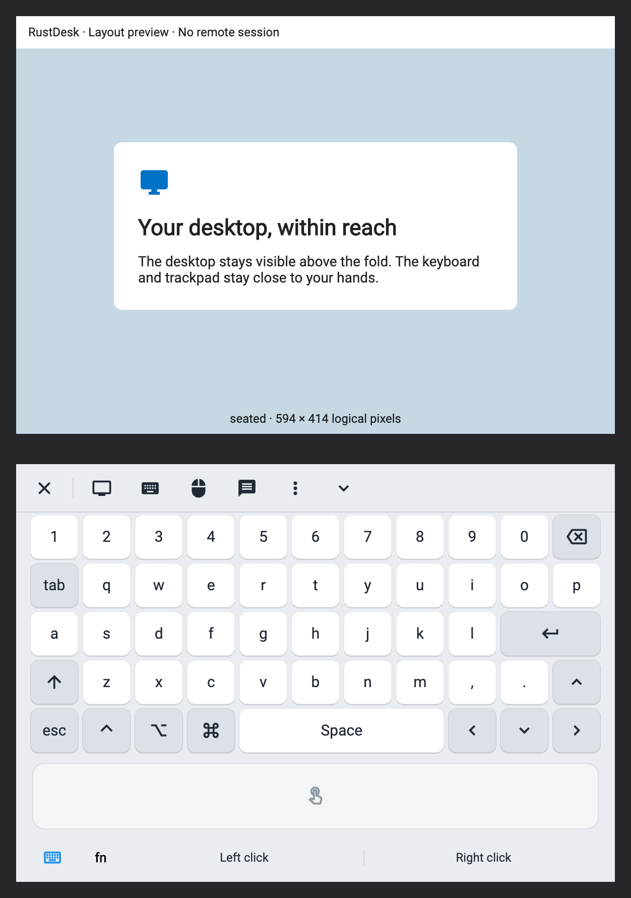
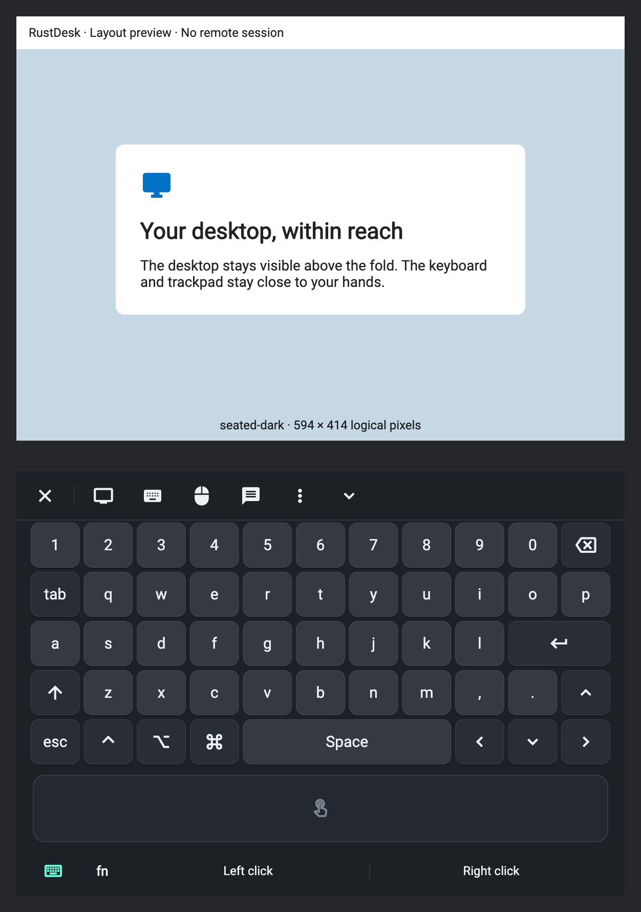
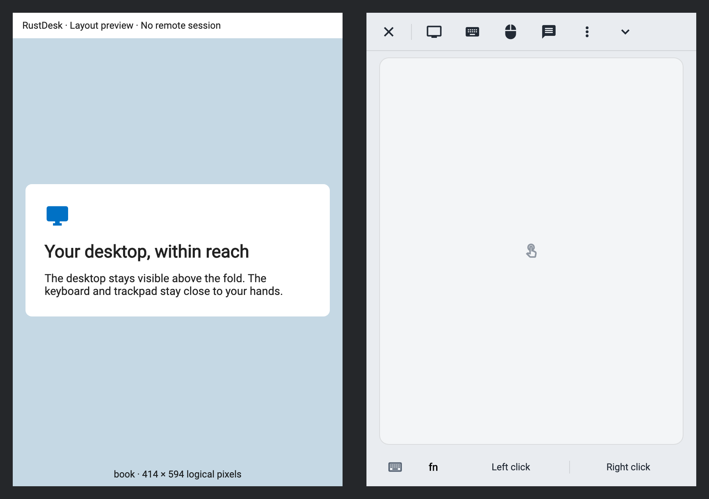
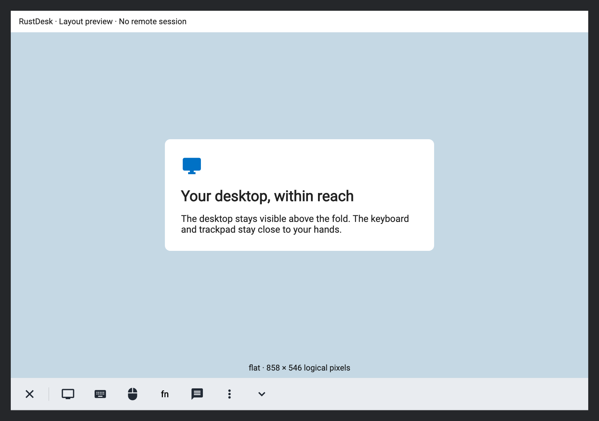
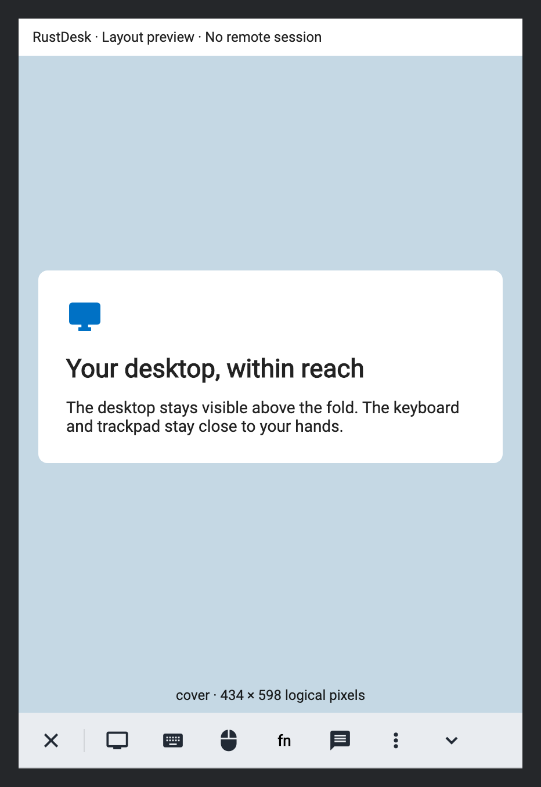

# Foldable iOS remote sessions

When UIKit reports folding capability, the remote session uses the current
window bounds and division regions to keep the desktop clear of the fold and
put input controls within reach. Device names, resolutions and orientations are
not used to identify folding hardware.

## Layouts

| Window / posture | Layout |
| --- | --- |
| Horizontal division | Remote desktop above the fold; keyboard and trackpad below |
| Vertical division | Remote desktop left; trackpad and optional keyboard right |
| Flat / cover, portrait or square | Full-width desktop above a compact bottom dock |
| Wide landscape | Desktop beside a narrow side rail |
| System keyboard | Same mounted session with keyboard insets applied to its canvas |
| Hidden controls | Full available desktop and a toolbar-reveal button |
| No folding capability | Original mobile session implementation |

The local Latin QWERTY keyboard supplements the system keyboard. macOS peers use
Command, Option and Control symbols; other peers retain Ctrl/Alt/Win conventions.
The Fn menu provides Escape, Tab, Enter, arrow keys, modifiers, F1-F12,
Home/End, Insert/Delete, Page Up/Down and
copy/paste/save shortcuts, including flat and cover modes. Windows/Linux peers
also have Print Screen, Scroll Lock, Pause and Menu. Other languages, punctuation
and IME composition use the existing system keyboard.

Trackpad tap left-clicks and long-press right-clicks; explicit click buttons are
also available. Existing display options, disconnect, control menus, chat,
physical keyboard handling, canvas gestures, floating mouse, relative mouse and
Android peer actions remain available. Gesture help opens as a sheet without
replacing the live session. View-only, keyboard permissions and the Wayland
keyboard-consent gate are checked at input dispatch.

## Screenshots

These are renders of the production layout, toolbar and input components with a
labelled demo desktop. They illustrate layout and appearance; they are not
captures of a remote connection. No personal desktop or device details appear.

| Seated | Seated, dark |
| --- | --- |
|  |  |

| Book | Flat | Cover |
| --- | --- | --- |
|  |  |  |

## Implementation

- `FoldableFlutterViewController` reports view-local bounds and reserved division
  frames over `rustdesk/foldable_layout`. It suppresses duplicate updates.
  Capability is published only after window attachment; a detached hierarchy
  must not determine the route for the rest of a session. New
  UIKit APIs are guarded by Swift compiler 6.4 and iOS 27.1 availability; older
  SDKs report unsupported capability. The deployment target is unchanged.
- The iOS route waits for initial capability before choosing its session tree,
  then retains that choice for the route lifetime. Pose changes update geometry.
  Unsupported devices continue through the original mobile implementation.
- `SessionOverlay` retains a full-window overlay and updates its base entry.
  Dialogs and chat sit outside the clipped remote canvas. The existing chat
  pointer-blocking behavior is retained. The toolbar-reveal button is anchored
  inside the canvas bounds, above the keyboard and clear of the fold.
  Keyboard insets and gesture help do not
  replace the live overlay or focused input tree.
- Division geometry for a differently sized window is ignored during transitions.
  The existing renderer uses an optional pane-size override. Pointer listeners
  inside that pane use local coordinates without a second safe-area subtraction.
  The override is cleared on disposal or fallback.

Authentication, public-server login requirements, codecs, transport, connection
policy, package versions and submodule revisions are unchanged.

## Validation

Validated with Flutter 3.24.5 / Dart 3.5.4 and Xcode 27.2. The full iOS release
build was signed, installed over the existing development app and launched on a
physical Duo. A saved macOS connection displayed the remote desktop; the system
keyboard opened, stayed visible through follow-up checks and dismissed with the
desktop geometry restored. The device owner accepted the build for contribution.

The nine focused tests cover geometry, action reachability, permission-checked
input, Mac modifier flags, keyboard/content retention through inset updates,
session/dialog retention through pose updates, clean disposal, and repeated
open/dismiss cycles using the real `OverlayDialogManager`, Fn navigation-key
dispatch with no keyboard panel, and toolbar restoration above the system keyboard.

```sh
cd flutter
flutter test --no-pub test/foldable_session_test.dart test/session_overlay_test.dart
```

The existing modifier, floating-mouse hold, keyboard-shortcut, local-shortcut and
cursor tests also passed. Combined result: **92 passed, one web-only test skipped**
on the VM. Targeted analysis reported four `WillPopScope` deprecation notices,
using the same navigation API as the original page, and no errors or warnings.
This was a targeted run, not the entire application test suite.

The two new control regressions first failed against the PR implementation:
Escape was absent from Fn, and the reveal button's bottom was 882 points while
the keyboard began at 540. Both now pass. A native simulator probe also subscribed
before window attachment: the original controller emitted unsupported capability;
the guarded controller emitted nothing until attachment, then reported supported
on Duo (`regions=1`) and unsupported on an ordinary iPhone (`regions=0`). The Duo
snapshot was valid before its first hinge callback. This uses the existing
hierarchy and region data without another startup flag. The updated iOS Release
build and strict signature verification passed.

The owner's physical iPhone Duo test preceded these review follow-ups. The
follow-ups were validated with VM tests, native simulator probes and a fresh iOS
build; they have not been rechecked in a physical remote session.

The full local iOS build used ignored generated bridge and native artifacts from
[CI run 41280309181](https://github.com/rustdesk/rustdesk/actions/runs/41280309181),
matching baseline `23e5bb471a040d62f0a6ad52591fb30784265b73`. Bridge codegen was not
run. Local signing and CocoaPods checksum changes were restored after building;
generated artifacts, signing material and preview tooling are excluded.

## Regression surface

| Existing file | Necessary change |
| --- | --- |
| `flutter/ios/Runner/Base.lproj/Main.storyboard` | Instantiate the geometry-supplying controller |
| `flutter/ios/Runner.xcodeproj/project.pbxproj` | Compile that controller; preserve upstream bundle/signing settings |
| `flutter/lib/mobile/pages/remote_page.dart` | Subscribe to native geometry, select the folding tree once and connect its controls to existing session APIs |
| `flutter/lib/models/model.dart` | Optional folding pane-size override and keyboard offset while the pane owns sizing |
| `flutter/lib/models/input_model.dart` | Local coordinates for listeners already inside the folding pane |
| `src/lang/*.rs`, except `en.rs` | Two new click-label keys using existing fallback conventions; Italian entries are empty |

The original bottom-toolbar method is byte-identical to baseline. The original
mobile-body method differs only by hiding its key-help overlay while a folding
viewport is active. Remaining logic is in new feature modules. Android and
desktop layout paths are unchanged.

## Known limits and remaining acceptance

- The local keyboard is Latin QWERTY; use the system keyboard for other input.
- Extended physical-device testing remains: repeated fold/rotate during live
  input, reconnect/error recovery, background/resume, host-side shortcuts, pointer
  alignment at different zoom levels, chat/voice and permission changes.
- One observed switch to Photos ended the console session with exit code 0. No
  new Runner crash report appeared; whether the switch was manual was not
  confirmed. This is not claimed as a diagnosed or fixed operating-system crash.
- Screenshots are component renders. Simulator layout checks and owner acceptance
  do not replace the remaining live-session matrix or ordinary-device checks.

## References

- [Apple: prepare for iPhone Duo](https://developer.apple.com/iphone-duo/prepare/)
- [Apple: adaptive layouts](https://developer.apple.com/videos/play/tech-talks/111463/)
- [iPhone Duo by Examples](https://github.com/artemnovichkov/iPhone-Duo-by-Examples)
- [Apple: UIHingeInteraction](https://developer.apple.com/documentation/uikit/uihingeinteraction)
- [Flutter iOS display-feature proposal](https://github.com/flutter/flutter/issues/192515)

The supplied mini-laptop reference informed the upper-display/lower-input
arrangement. The deck follows RustDesk's existing brightness and accent. No code
or assets were copied from the example projects.
