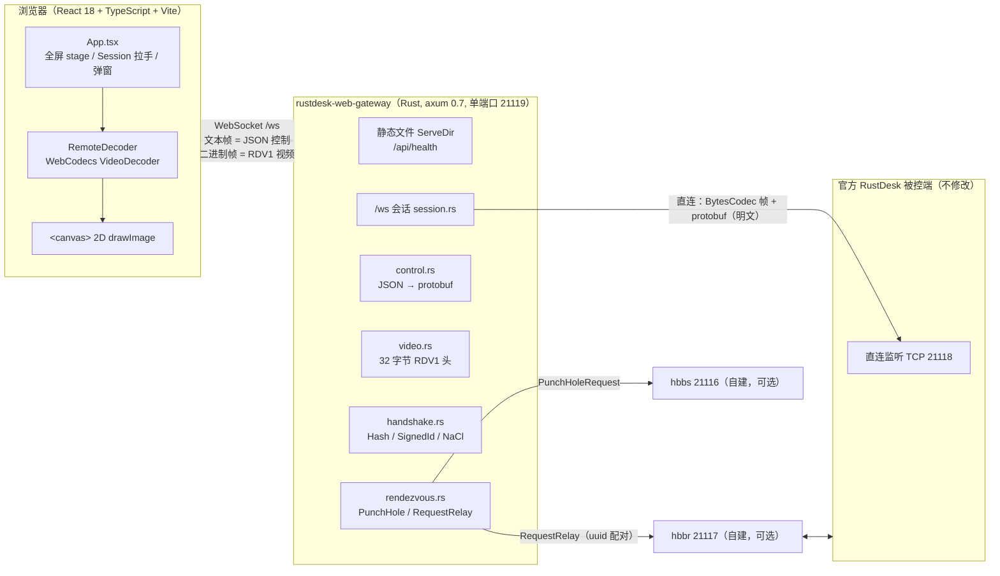
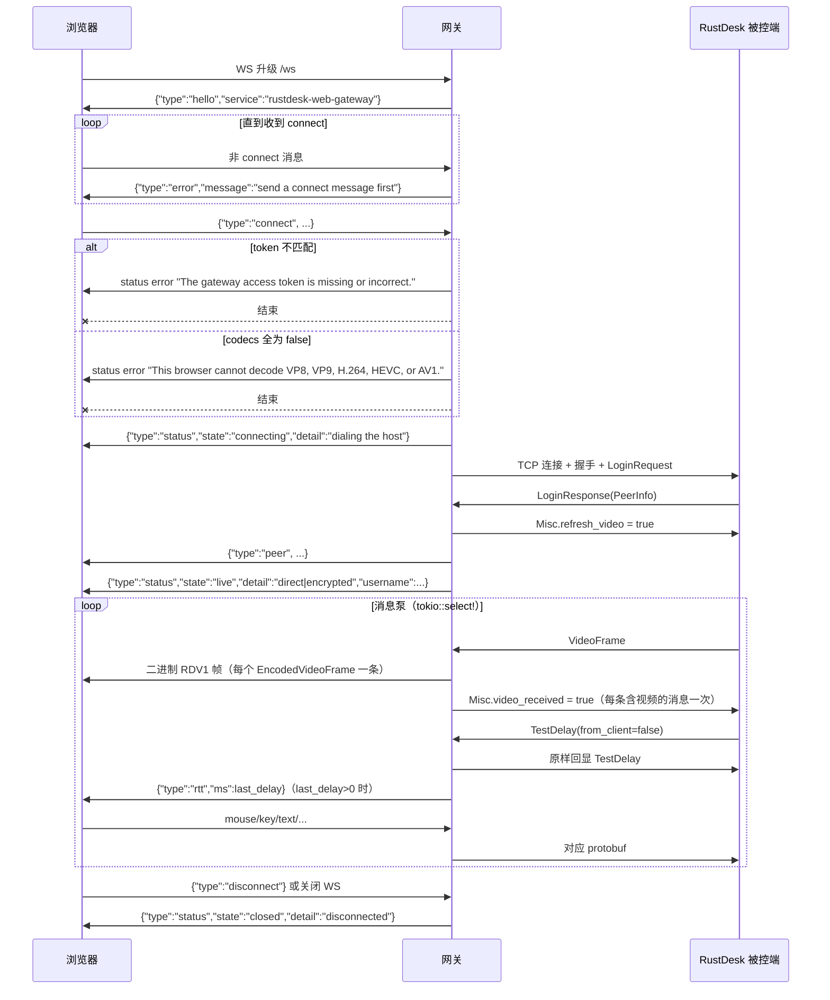
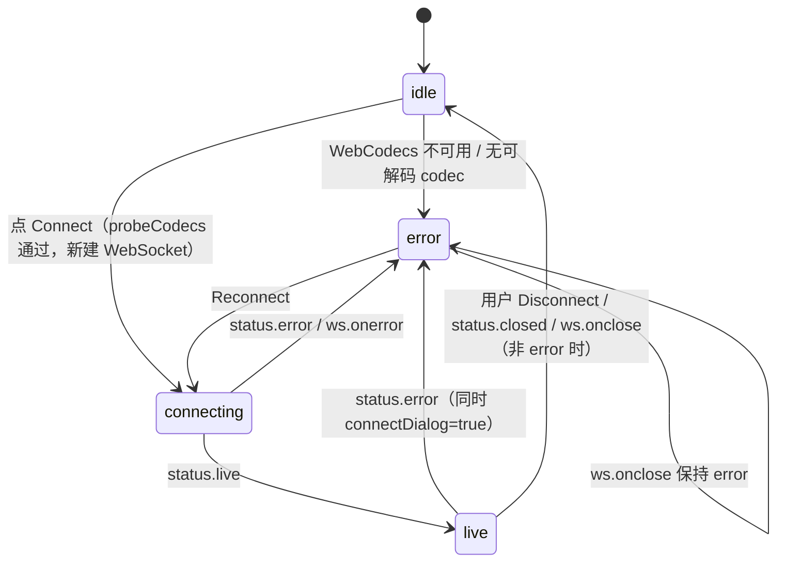

# RustDesk Web Client 实现规格书（可交给另一个 AI 编码代理从零实现）

> **文档依据**：仓库 <https://github.com/suijiafeng/rustdesk>，分支 `feature/web-client`，提交 **`e3cbc7669c424085cf55087b1f1e9ae12f2bd17a`**（`feat(web-client): match RustDesk phone gestures on the full-viewport client`，父提交 `41ea9a8e1c3fcb5795b557a644b318d5f60e6475`）。
> 子模块 `libs/hbb_common` 指向上游 <https://github.com/rustdesk/hbb_common> 的 `450cc1d7b729cfa8d19b5a7527c9cc2fe54cf5eb`。
> 本文所有字段、常量、阈值、公式都逐行对照上述提交的源码。凡是代码里**没有实现**或**有歧义**的地方，都会明确标注「未实现」「代码现状」「待确认」，不做臆测。
> 编写日期：2026-11-24（Asia/Tokyo）。

---

## 目录

1. 目标与范围
2. 总体架构
3. 目录结构与依赖
4. 网关（gateway）详细设计
5. WebSocket 协议规范
6. 前端详细设计
7. 部署
8. 测试与验收
9. 已知限制与坑
10. 分步实现计划与 Git 约定
- 附录 A：参考链接
- 附录 B：代码现状中值得注意的行为 / 疑似缺陷清单

---

## 1. 目标与范围

### 1.1 目标

- 在浏览器里远程控制一台**未经任何修改的官方 RustDesk 被控端**（测试基准版本 RustDesk **1.5.3**）。
- 被控端照常做屏幕采集与编码；服务器端**不转码**。网关只把被控端发来的已编码视频帧（VP8 / VP9 / H.264 / H.265 / AV1）原样转发给浏览器，由浏览器 WebCodecs `VideoDecoder` 解码并画到 `<canvas>`。
- 一个单端口 Rust 网关进程同时提供：静态页面、`GET /api/health`、`GET /ws`（WebSocket）。
- 两种连接方式：
  1. **直连 IP（主路径，已真机端到端验证）**：网关 TCP 直连被控端 `21118` 端口（被控端需开启「允许直接 IP 访问」）。
  2. **ID / 中继模式（代码与单测已完成，跨公网未实测）**：通过用户自建的 `hbbs`（`21116`）做打洞请求，失败或强制时走 `hbbr`（`21117`）中继。
- UI：连接后远程桌面占满整个视口；所有功能收进一个可沿顶边水平拖动的「Session」小拉手 + 弹窗菜单；连接表单是弹窗。交互参照 RustDesk 原生 App（缩放、平移、触控模式 / 鼠标模式、长按右键、双指点按右键等）。

### 1.2 非目标（MVP 不做）

- 音频回传（登录时显式 `disable_audio = Yes`）。
- 文件传输、端口转发、终端、摄像头、聊天、录屏。
- 服务器端转码、录制、对被控端采集器的任何改动。
- 不内置任何公共服务器公钥或账号凭据；ID 模式只能对接用户自己已有的 rendezvous 服务器。
- 被控端必须是**官方未修改版**，不允许为了 Web 端去改 host。

---

## 2. 总体架构

### 2.1 组件图



### 2.2 数据流

- **浏览器 → 网关**：WebSocket 文本帧，JSON，字段 `type` 区分消息（`connect` / `mouse` / `key` / `text` / `clipboard` / `switchDisplay` / `refresh` / `quality` / `disconnect`）。
- **网关 → 浏览器**：
  - 文本帧 JSON：`hello` / `status` / `peer` / `display` / `clipboard` / `cursor` / `error` / `rtt`。
  - 二进制帧：每个编码视频帧一条，32 字节头 + 原始编码字节（见 §4.9、§5.3）。
- **网关 ↔ 被控端**：RustDesk 原生协议，hbb_common `BytesCodec` 变长帧头 + protobuf `Message`（`libs/base/protos/message.proto`），在需要时用 NaCl `secretbox` 加密（直连模式被控端发明文 `Hash`，不加密；打洞 / 中继模式先 `SignedId` 再协商密钥）。

### 2.3 为什么零转码

- 被控端已经在做硬 / 软编码，浏览器 WebCodecs 能直接解 VP8/VP9/H.264/H.265/AV1，网关只做「拆 protobuf → 加 32 字节头 → 转发」，CPU 开销近似为零、没有额外延迟和画质损失。
- 网关不链接 `scrap`、ffmpeg、GUI，可以跑在很小的容器里（`debian:bookworm-slim`，`USER nobody`）。
- 代价：浏览器必须能解码被控端选中的编解码器。因此前端先用 `VideoDecoder.isConfigSupported` 探测，再把**只有浏览器真能解的**编解码器写进 `LoginRequest.option.supported_decoding`，让被控端只在这些里面选。

---

## 3. 目录结构与依赖

### 3.1 目录（`web-client/`，提交 e3cbc76）

| 路径 | 作用 |
| --- | --- |
| `web-client/README.md` | 使用说明（英文） |
| `web-client/Dockerfile` | 三阶段构建：node 构建前端 → rust 构建网关 → slim 运行镜像 |
| `web-client/docker-compose.yml` | `web` 服务 + `https` profile 的 `caddy` 服务 |
| `web-client/deploy/Caddyfile` | Caddy 反代（公网自动证书 / 局域网 `tls internal` 注释示例） |
| `web-client/deploy/nginx.conf` | nginx TLS 反代示例 |
| `web-client/.gitignore` | 忽略 `web/node_modules/`、`web/dist/`、`web/test-results/`、`gateway/target/`，但保留 `docs/screenshots/*.png` |
| `web-client/gateway/Cargo.toml` | crate `rustdesk-web-gateway` |
| `web-client/gateway/src/lib.rs` | 导出模块：`auth`、`control`、`direct`、`handshake`、`rendezvous`、`server`、`session`、`video`；`pub use hbb_common::ResultType` |
| `web-client/gateway/src/main.rs` | CLI（clap）、sodiumoxide 初始化、日志、启动 server |
| `web-client/gateway/src/server.rs` | axum 路由、`/api/health`、`/ws`、静态文件 |
| `web-client/gateway/src/session.rs` | 每个 WebSocket 的会话状态机、消息泵 |
| `web-client/gateway/src/control.rs` | 浏览器 JSON 消息定义与 → protobuf 转换、token 校验、错误人话化 |
| `web-client/gateway/src/direct.rs` | 直连拨号、`LoginRequest`、`OptionMessage` |
| `web-client/gateway/src/handshake.rs` | 读 `Hash` / `SignedId`、NaCl 密钥交换、rendezvous 安全握手 |
| `web-client/gateway/src/rendezvous.rs` | ID 模式：`PunchHoleRequest`、打洞 / 中继 |
| `web-client/gateway/src/auth.rs` | 密码双 SHA-256、直连 `username` 生成 |
| `web-client/gateway/src/video.rs` | RDV1 二进制帧头编解码、VP8 关键帧尺寸解析 |
| `web-client/web/package.json` 等 | 前端工程 |
| `web-client/web/src/App.tsx` | 唯一 React 组件（≈1107 行），全部 UI 与交互 |
| `web-client/web/src/decoder.ts` | 编解码探测、`RemoteDecoder` |
| `web-client/web/src/protocol.ts` | 二进制帧解析、服务端 JSON 类型、`wsUrl()` |
| `web-client/web/src/mapping.ts` | 视图变换与坐标映射纯函数 |
| `web-client/web/src/mapping.test.ts` | 4 个 vitest 用例 |
| `web-client/web/src/gestures.ts` | 手机手势阈值与判定纯函数（e3cbc76 新增） |
| `web-client/web/src/gestures.test.ts` | 4 个 vitest 用例（e3cbc76 新增） |
| `web-client/web/src/keys.ts` | `KeyboardEvent.code` → 控制键名 |
| `web-client/web/src/styles.css` | 全部样式 |
| `web-client/web/src/vite-env.d.ts` | `window.__rd` / `window.__rdView` 类型 |
| `web-client/web/e2e/loopback.mjs` | 桌面端 Playwright 回环 E2E |
| `web-client/web/e2e/mobile.mjs` | 手机端 Playwright E2E（Pixel 7 + iPhone 14 profile） |
| `web-client/scripts/e2e_desktop.py` | 被控端上运行的 Tk 全屏测试程序（点击 / 输入 / 拖拽 / 右键计数） |
| `web-client/docs/screenshots/*.png` | 截图：`desktop-connected`、`desktop-menu-open`、`desktop-zoomed`、`desktop-after-input`、`mobile-connect`、`mobile-connected`、`mobile-zoomed`、`mobile-menu`、`mobile-keyboard`、`mobile-landscape`、`iphone-connect`、`iphone-connected`、`iphone-landscape` |

### 3.2 根 `Cargo.toml` workspace

网关是根 workspace 的成员（第 220 行）：

```toml
[workspace]
members = ["libs/scrap", "libs/hbb_common", "libs/base", "libs/enigo", "libs/clipboard", "libs/virtual_display", "libs/virtual_display/dylib", "libs/portable", "libs/remote_printer", "web-client/gateway"]
exclude = ["vdi/host"]
```

同一文件里还有 `[patch.crates-io]`：`libxdo-sys` 指向 `libs/libxdo-sys-stub`，`tungstenite` 指向 `rustdesk-org/tungstenite-rs` rev `efce47e5364f00a63302cf07ab1fb13ded478914`。网关 crate 沿用这些 patch，不需要单独处理。

> **重要（这个 fork 和上游不一样）**：本 fork 把 `message.proto` 放在 **`libs/base/protos/message.proto`**，生成的 Rust 模块是 `base::message_proto`（`libs/base/src/lib.rs`：`pub use protos::message as message_proto;`），而 **`rendezvous.proto` 仍在 `hbb_common`**（`hbb_common::rendezvous_proto`）。网关代码因此同时依赖 `base` 和 `hbb_common`。如果下一个代理基于**上游** rustdesk 实现，`message_proto` 应改用 `hbb_common::message_proto`。

### 3.3 网关依赖（`web-client/gateway/Cargo.toml` 原文）

```toml
[package]
name = "rustdesk-web-gateway"
version = "0.1.0"
edition = "2021"
description = "WebSocket gateway that bridges a browser to an unmodified RustDesk host"
license = "AGPL-3.0-only"
publish = false

[[bin]]
name = "rustdesk-web-gateway"
path = "src/main.rs"

[dependencies]
hbb_common = { path = "../../libs/hbb_common" }
base = { path = "../../libs/base" }
axum = { version = "0.7", features = ["ws"] }
tokio = { version = "1.44", features = ["macros", "rt-multi-thread", "net", "time", "sync", "io-util"] }
serde = { version = "1", features = ["derive"] }
serde_json = "1"
sha2 = "0.10"
clap = { version = "4", features = ["derive", "env"] }
anyhow = "1"
bytes = "1.10"
futures-util = "0.3"
tower-http = { version = "0.6", features = ["cors", "fs"] }
uuid = { version = "1", features = ["v4"] }

[dev-dependencies]
tokio = { version = "1.44", features = ["macros", "rt-multi-thread", "net", "time", "sync", "io-util"] }
```

说明：`uuid`、`bytes` 在当前源码里没有被直接使用（仅声明）。

从 `hbb_common` 复用的东西：`tcp::FramedStream`、`Stream`（含 `send` / `next` / `next_timeout` / `set_negotiated_key` / `is_secured`）、`BytesCodec`、`socket_client::check_port`、`config::{RENDEZVOUS_PORT=21116, RELAY_PORT=21117}`、`AddrMangle`、`is_ip_str`、`sodiumoxide`、`rendezvous_proto::*`、`tcp::{KxTranscript, kx_version_for, KX_PARAMS_DOMAIN, KX_VERSION_LATEST, Encrypt}`、`log`、`env_logger`、`anyhow`、`bail!`、`protobuf`。

### 3.4 前端依赖（`web-client/web/package.json` 原文）

```json
{
  "name": "rustdesk-web-client",
  "private": true,
  "version": "0.1.0",
  "type": "module",
  "scripts": {
    "dev": "vite",
    "build": "tsc --noEmit && vite build",
    "typecheck": "tsc --noEmit",
    "lint": "tsc --noEmit",
    "test": "vitest run",
    "preview": "vite preview --host 127.0.0.1 --port 4173"
  },
  "dependencies": { "react": "^18.3.1", "react-dom": "^18.3.1" },
  "devDependencies": {
    "@types/react": "^18.3.12",
    "@types/react-dom": "^18.3.1",
    "@vitejs/plugin-react": "^4.3.4",
    "playwright": "^1.49.0",
    "typescript": "^5.6.3",
    "vite": "^5.4.11",
    "vitest": "^2.1.5"
  }
}
```

- 没有任何 UI 库、状态库、手势库；全部手写。
- `vite.config.ts`：`server.host = "127.0.0.1"`，`port = 5173`，代理 `"/api" → http://127.0.0.1:21119`，`"/ws" → { target: "ws://127.0.0.1:21119", ws: true }`。
- `vitest.config.ts`：`environment: "node"`，`include: ["src/**/*.test.ts"]`。
- `tsconfig.json`：`target ES2022`、`strict`、`noUnusedLocals`、`noUnusedParameters`、`jsx: react-jsx`、`moduleResolution: bundler`、`noEmit`、`types: ["vite/client"]`。
- `index.html`（e3cbc76）：

```html
<meta name="viewport" content="width=device-width, initial-scale=1, maximum-scale=1, user-scalable=no, viewport-fit=cover" />
<title>RustDesk Web Client</title>
<div id="root"></div>
<script type="module" src="/src/main.tsx"></script>
```

- `main.tsx`：`createRoot(#root).render(<StrictMode><App/></StrictMode>)`，引入 `./styles.css`。

---

## 4. 网关详细设计

### 4.1 CLI 参数与环境变量（`main.rs`）

| 参数 | 环境变量 | 默认值 | 说明 |
| --- | --- | --- | --- |
| `--listen <SocketAddr>` | `WEB_GATEWAY_LISTEN` | `127.0.0.1:21119` | 页面、健康检查、WebSocket 共用的监听地址 |
| `--static <PATH>` | `WEB_GATEWAY_STATIC` | 无 | 前端构建目录。未指定时依次尝试 `web-client/web/dist`、`web/dist`、`/app/web`，取第一个含 `index.html` 的目录；都没有就不提供静态文件 |
| `--token <STRING>` | `GATEWAY_TOKEN` | `""` | 访问口令。`trim()` 后为空等于不启用 |

启动顺序：`hbb_common::sodiumoxide::init()`（失败直接退出）→ `env_logger`（默认级别 `info`）→ 解析参数 → `server::serve(listen, GatewayConfig { static_dir, token })`。

### 4.2 HTTP 路由（`server.rs`）

```rust
Router::new()
    .route("/api/health", get(health))
    .route("/ws", get(ws))
    .layer(CorsLayer::permissive())
    .with_state(Arc::new(config));
// 有 static_dir 时：
router.fallback_service(ServeDir::new(&dir).not_found_service(ServeFile::new(dir.join("index.html"))));
```

| 方法 + 路径 | 行为 |
| --- | --- |
| `GET /api/health` | `{"ok":true,"service":"rustdesk-web-gateway","authRequired":<bool>}`，`authRequired` = token 存在且 trim 后非空 |
| `GET /ws` | WebSocket 升级，进入 `session::serve_socket(socket, token)` |
| 其他 | 静态文件；找不到时回落到 `index.html`（SPA） |

- CORS 为 `permissive`。
- **token 不在 HTTP 升级阶段校验**，而是在 WebSocket 内第一条 `connect` 消息的 `token` 字段里校验（§4.3）。
- 网关自身只说明文 HTTP / WS，TLS 由反代终止。

### 4.3 会话生命周期（`session.rs::serve_socket`）



细节：
- 等待 `connect` 期间：收到 `Close` 或流结束直接返回；二进制 / ping 等忽略；JSON 解析失败回 `{"type":"error","message":"bad message: <serde 错误>"}`。
- `codecs.selected()`：如果浏览器没上报（`reported=false`），网关只提供 VP8 + VP9（被控端可软编）。
- `run()` 返回 `Err` 时：日志 `session ended: {err:#}`，并发 `{"type":"status","state":"error","detail": humanize_error(err)}`。
- 正常结束（浏览器 `disconnect` 或 WS 关闭）：发 `status closed`。
- 被控端关闭：`bail!("host closed the connection")` → `status error`。
- 每 5 秒且有帧时打日志 `forwarded N video frames`；结束时 `session closed after N frames, M bytes`。
- 已连接后再发 `connect`：回 `{"type":"error","message":"already connected"}`。

### 4.4 直连流程（`direct.rs::connect_and_login`）

1. `port = target.port == 0 ? DEFAULT_DIRECT_PORT : target.port`，其中 `DEFAULT_DIRECT_PORT = RENDEZVOUS_PORT + 2 = 21118`（单测断言它也等于 `RELAY_PORT + 1`）。
2. `dial = check_port(host, port)`：IPv6 无方括号时补成 `[v6]:port`；host 不含 `:` 时补 `:port`；否则原样。
3. `username = direct_username(host, port)`（§4.7）。
4. `FramedStream::new(&dial, None, 8_000)`，连接超时 8 s，失败报 `failed to connect to {dial}`。
5. `handshake::read_until_hash(stream, None, "")`：直连被控端会**明文**发 `Hash`，返回 `encrypted=false`。
6. `login(...)`：发 `LoginRequest`，20 s 内等 `LoginResponse`。

### 4.5 帧格式（hbb_common `BytesCodec`）

TCP 上每条 protobuf 前面有 1~4 字节的小端变长头，低 2 位是「头长度 − 1」，其余位是 payload 长度：

```rust
// hbb_common/src/bytes_codec.rs（encode）
if data.len() <= 0x3F {
    buf.put_u8((data.len() << 2) as u8);
} else if data.len() <= 0x3FFF {
    buf.put_u16_le((data.len() << 2) as u16 | 0x1);
} else if data.len() <= 0x3FFFFF {
    let h = (data.len() << 2) as u32 | 0x2;
    buf.put_u16_le((h & 0xFFFF) as u16);
    buf.put_u8((h >> 16) as u8);
} else if data.len() <= MAX_FRAME_LENGTH /* 0x3FFF_FFFF */ {
    buf.put_u32_le((data.len() << 2) as u32 | 0x3);
} else { /* Overflow */ }
// decode_head：head_len = (src[0] & 0x3) + 1；n = 小端拼接 head_len 字节；n >>= 2
```

加密启用后，每条帧的 payload 是 `secretbox::seal(plain, nonce(seq), key)`；nonce 是 24 字节、前 8 字节为小端递增计数器（发送与接收各自从 1 开始），长度 ≤1 的帧不解密。直接复用 `hbb_common::Stream`，不要自己重写。

### 4.6 握手（`handshake.rs`）

#### 4.6.1 `read_until_hash(stream, peer_sign_pk, expected_id)`

10 s 内读第一条 `Message`：
- `Hash` → 返回 `(hash, encrypted=false)`（直连）。
- `SignedId` → `finish_signed_id`（打洞 / 中继）。
- 其他 → `bail!("expected Hash or SignedId, got another message")`。

#### 4.6.2 `finish_signed_id`

1. 如果有 `peer_sign_pk`（来自 rendezvous 服务器签名的 `IdPk`，见 §4.8），用它 `sign::verify(signed.id)`，解析 `IdPk { id, pk(32 字节 box 公钥), kx_version }`；`expected_id` 非空时要求 `opened.id == expected_id`。
2. **没法验证时**（没配置服务器公钥、或验证失败）：日志 `signed identity not verified, continuing without a stream key`，发**空的** `PublicKey {}`，然后等 `Hash`，返回 `encrypted=false`（与桌面客户端行为一致：不加密继续）。
3. 验证通过时：
   ```rust
   let (asymmetric, symmetric, key) = create_symmetric_key_msg(opened.pk);
   // create_symmetric_key_msg：
   //   (our_pk, our_sk) = box_::gen_keypair();
   //   key = secretbox::gen_key();
   //   nonce = box_::Nonce([0u8; 24]);
   //   sealed = box_::seal(&key.0, &nonce, &their_pk, &our_sk);
   //   返回 (our_pk 32 字节, sealed, key)
   let picked = tcp::kx_version_for(opened.kx_version); // = min(advertised, KX_VERSION_LATEST=1)
   send(Message::PublicKey { asymmetric_value: asymmetric, symmetric_value: symmetric, kx_version: picked });
   stream.set_negotiated_key(key, /*is_initiator*/ true, &KxTranscript {
       initiator_pk: &asymmetric, responder_pk: &opened.pk,
       advertised: opened.kx_version, picked,
   })?;
   let hash = recv_hash(stream).await?; // 10 s 内跳过非 Hash 消息
   // 返回 encrypted = true
   ```
4. `set_negotiated_key`（hbb_common `stream.rs`）：`picked == 0` → 双向同一把 key；`picked == 1` → `Encrypt::new_split`：用 `generichash(key=交换的 key, 输出 32 字节)` 依次喂入 `b"rdkx-spl"`、方向字节（发起方 1 / 响应方 2）、`advertised` LE u32、`picked` LE u32、`initiator_pk`、`responder_pk`，派生出两把方向子密钥；发起方用「1」发送、用「2」接收。其他版本报错。

#### 4.6.3 `secure_rendezvous(stream, key_b64)`（连 hbbs / hbbr 时用）

- `key_b64` 为空：不加密，返回 `false`。
- `rs_pk = rs_public_key(key_b64)`：标准 base64（`Variant::Original`）解码，长度必须 32。
- 8 s 内读第一条 `RendezvousMessage`；不是 `KeyExchange` 就 `warn!` 并保持明文返回 `false`。
- `ex.keys.len()` 必须为 1；`their = sign::verify(ex.keys[0], rs_pk)`，长度 32。
- 若 `their_pk[31] & 0x80 != 0` 或 `ex.signed_params` 非空：验证 `signed_params`，去掉前缀 `b"rdkx-params"`，解析 `KxParams`，要求 `params.pk == their_pk && params.version == ex.version`。
- 生成 `(asymmetric, symmetric, key) = create_symmetric_key_msg(their_pk)`，`picked = kx_version_for(ex.version)`，回 `KeyExchange { keys: [asymmetric, symmetric], version: picked }`，`set_negotiated_key(key, true, transcript)`，返回 `true`。

### 4.7 认证（`auth.rs`）

#### 4.7.1 密码响应 = 双 SHA-256

```rust
/// h1 = SHA256(password || salt), response = SHA256(h1 || challenge)
pub fn password_response(password: &str, salt: &str, challenge: &str) -> Vec<u8> {
    let mut h1 = Sha256::new();
    h1.update(password.as_bytes());
    h1.update(salt.as_bytes());
    let h1 = h1.finalize();
    let mut h2 = Sha256::new();
    h2.update(&h1[..]);          // 注意：拼的是 h1 的 32 字节原始摘要，不是 hex
    h2.update(challenge.as_bytes());
    h2.finalize().to_vec()       // 32 字节原始摘要放进 LoginRequest.password（bytes）
}
```

测试向量（单测）：`password_response("pw", "salt", "b") == hex 803235e4d1ed7843e834f5e27655ea12b7ab5c194226dd10e6aebcc9d3dc5ec1`。

#### 4.7.2 直连 `username`

被控端只在 `username` 是「IP（可带端口）」或「`host:port` 域名」时接受直连会话：

```rust
pub fn direct_username(host: &str, port: u16) -> String {
    let host = host.trim();
    if hbb_common::is_ip_str(host) && host_has_port(host) { return host.to_owned(); }
    if let Some(ip) = resolve_ip(host) { return format!("{ip}:{port}"); }   // 域名先解析成 IP
    format!("{host}:{port}")
}
// host_has_port：以 '[' 开头时看是否含 "]:"；否则恰好一个 ':'
// resolve_ip：先尝试直接 parse IpAddr；否则取 ':' 前部分做 DNS (ToSocketAddrs (host,0)) 取第一个
```

单测：`direct_username("127.0.0.1:21118", 21118) == "127.0.0.1:21118"`；`direct_username("127.0.0.1", 21118) == "127.0.0.1:21118"`。
注意：IPv6 裸地址（如 `::1`）会解析成 IP，再拼成 `::1:21118`（没有方括号），这一点代码未特殊处理，属于**待确认**行为。

#### 4.7.3 网关 token

```rust
pub fn token_matches(expected: Option<&str>, given: &str) -> bool {
    let Some(expected) = expected.map(str::trim).filter(|s| !s.is_empty()) else { return true };
    let a = expected.as_bytes(); let b = given.trim().as_bytes();
    if a.len() != b.len() { return false; }
    let mut diff = 0u8; for (x, y) in a.iter().zip(b.iter()) { diff |= x ^ y; }
    diff == 0   // 等长常数时间比较；两端都 trim
}
```

### 4.8 `LoginRequest` 与 `OptionMessage`（`direct.rs::login` / `login_options`）

```rust
lr.username    = username;                         // 直连：IP:port；ID 模式：peer_id.trim()
lr.password    = password_response(pw, &hash.salt, &hash.challenge);
lr.my_id       = "web-client";
lr.my_name     = "Web Client";
lr.my_platform = "Web";
lr.version     = "1.5.3";
lr.option      = login_options(codecs);
// 未设置：video_ack_required、session_id、hwid、os_login、avatar、trusted_device_*
```

```rust
let caps = codecs.selected();
decoding.ability_vp8  = caps.vp8  as i32;
decoding.ability_vp9  = caps.vp9  as i32;
decoding.ability_av1  = caps.av1  as i32;
decoding.ability_h264 = caps.h264 as i32;
decoding.ability_h265 = caps.h265 as i32;
decoding.prefer        = PreferCodec::Auto;
decoding.prefer_chroma = Chroma::I420;   // i444 字段保持 None
OptionMessage {
    supported_decoding: Some(decoding),
    custom_fps: 30,
    image_quality: ImageQuality::Balanced,
    disable_audio: BoolOption::Yes,
    ..Default::default()
}
```

等待响应（20 s 截止，`timed out waiting for LoginResponse`）：
- `LoginResponse.error` → `Err(error)`；空串时报 `the host rejected the login`。
- `LoginResponse.peer_info` 或顶层 `Message.peer_info` → 成功。
- 其他消息（包括被控端在登录前可能发的其他东西）跳过继续等。

登录成功后，网关立即发一次 `Misc { refresh_video: true }`，请求被控端发关键帧。

### 4.9 ID / 中继模式（`rendezvous.rs`）

输入 `IdTarget { peer_id, password, id_server, relay_server, key, force_relay }`。

1. 校验：`peer_id` 为空 → `peer id is empty`；`id_server` 为空 → `id server is empty`。
2. 连 `check_port(id_server, 21116)`，超时 10 s。
3. `key` 非空时 `secure_rendezvous(id_socket, key)`。
4. 发：
   ```rust
   PunchHoleRequest {
       id: peer_id.trim(), licence_key: key.trim(),
       nat_type: if force_relay { SYMMETRIC } else { UNKNOWN_NAT },
       conn_type: DEFAULT_CONN, force_relay, version: "1.5.3", ..Default
   }
   ```
5. 20 s 内循环读：
   - `PunchHoleResponse` → `finish_punch`。
   - `RelayResponse` → `finish_relay`。
   - `PunchHoleSent` 及其他 → 忽略。
6. **`finish_punch`**：
   - `socket_addr` 为空：按 `other_failure` 或 `failure` 报错：`ID_NOT_EXIST` → `ID does not exist`；`OFFLINE` → `remote desktop is offline`；`LICENSE_MISMATCH` → `key mismatch`；`LICENSE_OVERUSE` → `key overuse`；其他 → `punch hole failed`。
   - 否则 `AddrMangle::decode(socket_addr)`，直接 TCP 连接（10 s）。**注意：这只是「直接 TCP 连过去」，并没有做真正的双向 TCP 打洞（没有本地端口复用 / 同时 connect）**，所以只有对端地址可直达时才会成功。
   - `peer_sign_key(target, ph.pk)` → `read_until_hash(stream, sign_pk, peer_id)`。
7. **`finish_relay`**：
   - `refuse_reason` 非空 → 报错。
   - `uuid` 必须非空、≤128 字节、只含 `[A-Za-z0-9_-]`，否则 `invalid relay uuid`。
   - 中继地址：用户填了 `relay_server` 就用它，否则用 `rr.relay_server`；都空 → `relay server is empty`。
   - 连 `check_port(relay_host, 21117)`（10 s），发 `RequestRelay { id: peer_id, uuid, licence_key: key, conn_type: DEFAULT_CONN }`。
   - **代码现状**：网关在中继 socket 上**没有**调用 `secure_rendezvous`（中继连接本身不做 KeyExchange），直接发 `RequestRelay`。
   - `peer_sign_key(target, rr.pk())` → `read_until_hash(...)`。
8. **`peer_sign_key`**：`key` 为空或服务器没给签名 → `None`（随后走「空 PublicKey、不加密」路径）；否则用 `rs_public_key(key)` 打开 `IdPk`，要求 `opened.id == peer_id`，否则 `identity server signed a different id (...)`；返回 `sign::PublicKey(opened.pk)`。

   > 这里有个**需要注意的语义**：`peer_sign_key` 返回的是 rendezvous 签过的 `IdPk.pk`，然后把它当作 `sign::PublicKey` 去验证被控端发来的 `SignedId`。这与桌面客户端一致（被控端的 `SignedId` 由其 sign 私钥签名，hbbs 返回的 pk 是被控端注册的 sign 公钥）。实现时照搬即可。
9. 打洞 / 中继拿到 `Hash` 后，回到 `direct::login`（username = `peer_id`）。

### 4.10 消息泵（`session.rs::run`）

`tokio::select!` 同时等浏览器与被控端：

**浏览器 → 被控端**（`handle_browser`）：
- 解析失败 → 回 `error bad message: ...`，继续。
- `disconnect` → 退出循环。
- `connect` → 回 `error already connected`。
- 其他 → `control::to_host_message` → `stream.send`（返回 `None` 的不发）。

**被控端 → 浏览器**（每条 `Message`）：
1. `TestDelay` 且 `from_client == false` → **原样回显**给被控端；若 `last_delay > 0`，发 `{"type":"rtt","ms":last_delay}`。
2. `describe_control`：
   - `Misc.switch_display` → 更新当前尺寸（宽高 >0 时）并发 `{"type":"display","display":d,"width":w,"height":h,"name":""}`。
   - `Misc.close_reason` → `{"type":"status","state":"error","detail":reason}`（不主动断开，循环继续直到被控端关闭）。
   - `Clipboard`：`compress == true` 时丢弃；UTF-8 lossy 解码；超过 256 KiB 丢弃；否则 `{"type":"clipboard","text":...}`。
   - `CursorPosition` → `{"type":"cursor","x":..,"y":..}`。
3. 首次收到 `VideoFrame.rgb` / `VideoFrame.yuv`（原始未压缩帧）时，发一次 `{"type":"error","message":"the host sent uncompressed video; this client only decodes vp8, vp9, h264, and av1"}`。
4. `take_frames`：`VideoFrame.vp8s/vp9s/h264s/h265s/av1s` 中**每个** `EncodedVideoFrame` 生成一条二进制帧：
   - `codec`：VP8=1、VP9=2、H264=3、H265=4、AV1=5。
   - `key = frame.key`，`pts = frame.pts`，`display = max(vf.display, 0) as u16`。
   - `width/height`：来自会话当前尺寸 `size`。初值 = `PeerInfo.displays[current_display]`（越界取第一个，再没有就 0×0）；收到 `SwitchDisplay` 时更新；**仅 VP8** 会额外从关键帧头解析真实编码尺寸（`vp8_keyframe_size`）。H.264/H.265/VP9/AV1 不解析码流尺寸。
   - `gateway_unix_ms = SystemTime::now()` 毫秒。
5. 本条消息里只要有视频帧，就回被控端一次 `Misc { video_received: true }`（RustDesk 1.5 的 QoS 需要这个 ACK，否则会判定链路卡死降帧）。

`peer` JSON（`peer_json`）：

```json
{
  "type": "peer",
  "hostname": "…", "platform": "Linux", "username": "…", "version": "1.5.3",
  "currentDisplay": 0,
  "displays": [{"index":0,"name":"…","x":0,"y":0,"width":1280,"height":720,"online":true}],
  "encoding": {"vp8":true,"h264":false,"h265":false,"av1":false},   // PeerInfo.encoding 缺失时为 null
  "encrypted": false
}
```

### 4.11 浏览器指令 → protobuf（`control.rs`）

#### 4.11.1 鼠标

```rust
pub const MOUSE_TYPE_MOVE: i32 = 0;
pub const MOUSE_TYPE_DOWN: i32 = 1;
pub const MOUSE_TYPE_UP: i32 = 2;
pub const MOUSE_TYPE_WHEEL: i32 = 3;
pub const MOUSE_BUTTON_LEFT: i32 = 0x01;
pub const MOUSE_BUTTON_RIGHT: i32 = 0x02;
pub const MOUSE_BUTTON_WHEEL: i32 = 0x04;   // 中键

let kind = match action { "down" => 1, "up" => 2, "wheel" => 3, _ => 0 /* move */ };
let button = if kind == WHEEL || kind == MOVE { 0 }
             else { match button { "right" => 0x02, "middle" => 0x04, _ => 0x01 } };
ev.mask = (button << 3) | kind;
ev.x = x; ev.y = y;      // move/down/up：远端像素坐标；wheel：x,y 为滚动增量
// MouseEvent.modifiers 不设置
```

例：左键按下 `mask = (1<<3)|1 = 9`；右键抬起 `(2<<3)|2 = 18`；滚轮 `mask = 3`，`y = +1` 向上一格（前端用 `-sign(deltaY)`）。

#### 4.11.2 键盘

```rust
fn key_message(action, control, chr, text, modifiers) -> Option<Message> {
    ev.mode  = KeyboardMode::Legacy;
    ev.down  = action != "up";
    ev.press = action == "press";
    for name in modifiers { if let Some(k) = control_key(name) { ev.modifiers.push(k) } }
    if !control.is_empty()          { ev.set_control_key(control_key(control).unwrap_or(ControlKey::Unknown)); }
    else if let Some(ch) = chr.chars().next() { ev.set_chr(ch as u32); }   // chr = Unicode 码点
    else if !text.is_empty()        { ev.press = true; ev.set_seq(text); }
    else { return None; }
}
// type:"text" → KeyEvent { mode: Legacy, press: true, seq: text }（text 为空则不发）
```

`control_key` 名称表（大小写敏感）：

| 名称 | ControlKey | 名称 | ControlKey |
| --- | --- | --- | --- |
| `Alt` | Alt | `Home` | Home |
| `Backspace` | Backspace | `ArrowLeft` / `Left` | LeftArrow |
| `CapsLock` | CapsLock | `Meta` / `Super` / `Win` | Meta |
| `Control` / `Ctrl` | Control | `PageDown` | PageDown |
| `Delete` | Delete | `PageUp` | PageUp |
| `ArrowDown` / `Down` | DownArrow | `Enter` / `Return` | Return |
| `End` | End | `ArrowRight` / `Right` | RightArrow |
| `Escape` / `Esc` | Escape | `Shift` | Shift |
| `F1` … `F12` | F1 … F12 | `Space` | Space |
| `Tab` | Tab | `ArrowUp` / `Up` | UpArrow |
| `CtrlAltDel` | CtrlAltDel | `LockScreen` | LockScreen |

不在表中的 `control` 名称 → `ControlKey::Unknown`。未支持：Insert、PrintScreen、NumLock、小键盘、多媒体键等（proto 里有，但映射表没有）。

#### 4.11.3 其他

| 浏览器消息 | protobuf |
| --- | --- |
| `clipboard {text}` | `Clipboard { content: text 的 UTF-8 字节, compress: false, 其余默认 }` |
| `switchDisplay {display}` | `Misc { switch_display: SwitchDisplay { display, ..默认 } }` |
| `refresh` | `Misc { refresh_video: true }` |
| `quality {quality, fps}` | `Misc { option: OptionMessage { image_quality: low→Low / best→Best / balanced→Balanced / 其他→NotSet, custom_fps: fps（仅 fps>0） } }` |

`frame_meta_json()`（生成 `{"type":"video",...}`）在源码中定义但**未被调用**，可以不实现。

### 4.12 错误人话化（`humanize_error`）

按顺序匹配小写后的错误文本：

| 包含 | 返回（原文英文） |
| --- | --- |
| `wrong password` | The host rejected the password. Check the permanent password and connect again. |
| `empty password` 或 `no password access` | The host requires a password. Enter the permanent password set on the desktop and connect again. |
| `offline` 或 `id does not exist` | The remote desktop is offline, or the ID does not match this host. |
| `connection refused` / `failed to connect` / `os error 111` / `network is unreachable` | Cannot reach the host. Check the address and port, and confirm direct IP access is enabled on the desktop. |
| `timed out` / `timeout` | The host did not answer in time. It may be offline, or a firewall is blocking the port. |
| `gateway access token` | The gateway access token is missing or incorrect. |
| 其他 | 原文 |

### 4.13 网关单元测试（`cargo test --manifest-path web-client/gateway/Cargo.toml`）

| 模块 | 测试 | 断言 |
| --- | --- | --- |
| `auth` | `password_response_matches_the_host_formula` | 测试向量 `803235e4…5ec1` |
| `auth` | `direct_username_keeps_an_ipv4_with_port` | 见 §4.7.2 |
| `direct` | `direct_port_matches_the_host_listener` | 21118 = RELAY_PORT+1 = RENDEZVOUS_PORT+2 |
| `direct` | `login_advertises_only_probed_codecs_and_i420` | 只开 vp8+h264；i444 None；prefer_chroma I420 |
| `handshake` | `plaintext_hash_then_login_roundtrip` | 本地 TCP 对：host 发明文 Hash，客户端回 LoginRequest，password 正确，username `127.0.0.1:21118` |
| `handshake` | `nacl_handshake_encrypts_the_password_challenge` | host 发签名 `IdPk`（kx_version=LATEST），客户端回 PublicKey，host 用 `Encrypt::decode` 拆出 key、`set_negotiated_key(false)`，加密发 Hash，客户端 `encrypted=true`、`is_secured()` |
| `server` | `health_reports_whether_a_token_is_required` | health JSON |
| `video` | `header_roundtrip_keeps_payload_and_keyframe_flag` | encode/decode 往返（含负 pts） |
| `video` | `reject_short_or_foreign_frames` | 长度不足或 magic 不对返回 None |
| `video` | `vp8_keyframe_size_reads_the_uncompressed_header` | 1280×720；非关键帧返回 None |
| `control` | `mouse_down_packs_the_rustdesk_mask` | mask = (1<<3)\|1 |
| `control` | `wheel_uses_deltas_without_a_button` | mask = 3，y=-1 |
| `control` | `text_and_escape_become_legacy_key_events` | text→seq；Escape→control |
| `control` | `header_len_stays_in_sync_with_the_documented_layout` | HEADER_LEN=32 |
| `control` | `password_and_unreachable_errors_are_plain_language` | humanize |
| `control` | `gateway_token_is_optional_and_exact` | token 规则 |
| `control` | `unprobed_codecs_offer_only_software_vp8_and_vp9` | 默认 vp8+vp9 |
| `control` | `video_received_is_a_misc_flag` | `Misc.video_received(true)` |

---

## 5. WebSocket 协议规范

- 端点：与页面同源的 `/ws`。前端 `wsUrl()`：`location.protocol === "https:" ? "wss:" : "ws:"` + `//${location.host}/ws`。
- `binaryType = "arraybuffer"`。
- 文本帧都是 JSON 对象，必有 `type` 字段。网关用 serde `#[serde(tag = "type", rename_all = "camelCase")]` 解析，**变体名**做 camelCase（所以是 `switchDisplay`），**字段名**按表中写法（`peerId`、`idServer`、`relayServer`、`forceRelay` 是显式 rename 的）。缺省字段取默认值（空串 / 0 / false）。
- 未知 `type` 或字段类型不对 → 网关回 `{"type":"error","message":"bad message: ..."}`，不断开。

### 5.1 浏览器 → 网关

| type | 字段 | 类型 / 取值 | 说明 |
| --- | --- | --- | --- |
| `connect` | `mode` | `"direct"` \| `"id"`（必填；非 `"id"` 一律按直连） | 第一条必须是它 |
| | `host` | string | 直连主机（IP / 域名 / 可带 `:port`） |
| | `port` | u16 | 0 → 21118 |
| | `password` | string | 被控端永久密码（明文发给网关，由网关做哈希） |
| | `peerId` | string | ID 模式 |
| | `idServer` | string | ID 模式 hbbs 地址，可带端口，默认 21116 |
| | `relayServer` | string | 可选，覆盖 hbbs 返回的中继地址，默认端口 21117 |
| | `key` | string | 可选，服务器公钥（标准 base64，32 字节） |
| | `forceRelay` | bool | 强制中继 |
| | `token` | string | 网关口令 |
| | `codecs` | `{vp8,vp9,h264,h265,av1,reported}` 全 bool | 浏览器探测结果；`reported=false` 时网关只报 vp8+vp9 |
| `mouse` | `action` | `"move"` \| `"down"` \| `"up"` \| `"wheel"`（其他值按 move） | |
| | `button` | `"left"` \| `"right"` \| `"middle"`（缺省 left；move/wheel 忽略） | |
| | `x`,`y` | i32 | 远端像素坐标；wheel 时为增量（前端只发 −1/0/+1） |
| `key` | `action` | `"down"` \| `"up"` \| `"press"` | 前端只用 down/up |
| | `control` | 控制键名（§4.11.2） | 优先级最高 |
| | `chr` | 单字符字符串 | 取第一个字符的码点放入 `KeyEvent.chr` |
| | `text` | string | 前两者都空时作为 `seq` |
| | `modifiers` | string[]（控制键名） | 放入 `KeyEvent.modifiers` |
| `text` | `text` | string | `KeyEvent{press:true, seq}`；空串忽略 |
| `clipboard` | `text` | string | 写被控端剪贴板（前端目前**没有**发送它的 UI） |
| `switchDisplay` | `display` | i32 | 切换显示器 |
| `refresh` | — | | 请求关键帧 |
| `quality` | `quality` | `"low"` \| `"balanced"` \| `"best"` \| 其他=NotSet | 前端目前**没有**发送它的 UI |
| | `fps` | i32 | >0 才设置 |
| `disconnect` | — | | 结束会话 |

示例：

```json
{"type":"connect","mode":"direct","host":"192.168.1.20","port":21118,"password":"secret","token":"","codecs":{"vp8":true,"vp9":true,"h264":true,"h265":false,"av1":true,"reported":true}}
{"type":"connect","mode":"id","peerId":"123456789","idServer":"hbbs.example.com","relayServer":"","key":"OeVuKk5nlHiXp+APNn0Y3pC1Iwpwn44JGqrQCsWqmBw=","forceRelay":false,"password":"secret","token":"desk","codecs":{"vp8":true,"vp9":true,"h264":false,"h265":false,"av1":false,"reported":true}}
{"type":"mouse","action":"down","button":"left","x":640,"y":180}
{"type":"mouse","action":"wheel","x":0,"y":-1}
{"type":"key","action":"down","control":"Control","modifiers":["Control"]}
{"type":"key","action":"down","chr":"c","modifiers":["Control"]}
{"type":"text","text":"你"}
{"type":"switchDisplay","display":1}
{"type":"refresh"}
{"type":"disconnect"}
```

（`key` 示例里的 base64 只是格式示意，不是真实服务器公钥。）

### 5.2 网关 → 浏览器（文本）

| type | 字段 | 何时发送 |
| --- | --- | --- |
| `hello` | `service: "rustdesk-web-gateway"` | WS 建立后立刻 |
| `status` | `state: "connecting"`，`detail: "dialing the host"` | 收到合法 connect 后 |
| `status` | `state: "live"`，`detail: "encrypted"` \| `"direct"`，`username` | 登录成功（在 `peer` 之后） |
| `status` | `state: "error"`，`detail` | token 错、无可用编解码器、任何会话错误、被控端 `Misc.close_reason` |
| `status` | `state: "closed"`，`detail: "disconnected"` | 正常结束 |
| `peer` | `hostname, platform, username, version, currentDisplay, displays[], encoding\|null, encrypted` | 登录成功 |
| `display` | `display, width, height, name:""` | 被控端 `Misc.switch_display` |
| `clipboard` | `text` | 被控端剪贴板（未压缩、≤256 KiB）（前端目前**忽略**） |
| `cursor` | `x, y` | 被控端 `CursorPosition`（前端目前**忽略**） |
| `rtt` | `ms` | 被控端 `TestDelay.last_delay > 0` |
| `error` | `message` | 非致命错误（bad message、already connected、原始视频警告、未先 connect） |

前端 TypeScript 类型（`protocol.ts`）：

```ts
export type ServerMessage =
  | { type: "hello"; service: string }
  | { type: "status"; state: string; detail?: string }
  | PeerMessage   // { type:"peer"; hostname; platform; username; version; currentDisplay; displays: DisplayInfo[]; encrypted }
  | { type: "display"; display: number; width: number; height: number }
  | { type: "clipboard"; text: string }
  | { type: "cursor"; x: number; y: number }
  | { type: "error"; message: string }
  | { type: "rtt"; ms: number };
// DisplayInfo = { index, name, x, y, width, height, online }
// 注意：PeerMessage 类型里没有 encoding 字段（网关发了，前端没声明也没用）
```

### 5.3 网关 → 浏览器（二进制视频帧，RDV1）

全部小端。每个 `EncodedVideoFrame` 一条 WebSocket 二进制消息。

| 偏移 | 长度 | 字段 | 类型 | 说明 |
| --- | --- | --- | --- | --- |
| 0 | 4 | magic | `b"RDV1"` = `52 44 56 31` | |
| 4 | 1 | codec | u8 | 1=vp8 2=vp9 3=h264 4=h265 5=av1 |
| 5 | 1 | flags | u8 | bit0 = 关键帧 |
| 6 | 2 | display | u16 LE | |
| 8 | 4 | width | u32 LE | 见 §4.10 第 4 步来源 |
| 12 | 4 | height | u32 LE | |
| 16 | 8 | pts | i64 LE | 被控端 pts（前端不用） |
| 24 | 8 | gateway_unix_ms | u64 LE | 网关转发时刻 |
| 32 | N | payload | bytes | 被控端编码器原始输出，未改动 |

网关编码（`video.rs`）：

```rust
out.extend_from_slice(b"RDV1");
out.push(packet.codec);
out.push(if packet.key { 0b0000_0001 } else { 0 });
out.extend_from_slice(&packet.display.to_le_bytes());
out.extend_from_slice(&packet.width.to_le_bytes());
out.extend_from_slice(&packet.height.to_le_bytes());
out.extend_from_slice(&packet.pts.to_le_bytes());
out.extend_from_slice(&packet.gateway_unix_ms.to_le_bytes());
out.extend_from_slice(packet.data);
```

前端解码（`protocol.ts`）：

```ts
export const HEADER_LEN = 32;
export function decodeFrame(buf: ArrayBuffer): VideoPacket | null {
  if (buf.byteLength < HEADER_LEN) return null;
  const view = new DataView(buf);
  if (view.getUint8(0) !== 0x52 || view.getUint8(1) !== 0x44 ||
      view.getUint8(2) !== 0x56 || view.getUint8(3) !== 0x31) return null;
  const codec = view.getUint8(4);
  return {
    codec, codecName: CODEC_NAMES[codec] ?? "unknown",   // {1:"vp8",2:"vp9",3:"h264",4:"h265",5:"av1"}
    key: (view.getUint8(5) & 1) !== 0,
    display: view.getUint16(6, true),
    width: view.getUint32(8, true),
    height: view.getUint32(12, true),
    pts: Number(view.getBigInt64(16, true)),
    gatewayUnixMs: Number(view.getBigUint64(24, true)),
    data: new Uint8Array(buf, HEADER_LEN),
  };
}
```

VP8 关键帧尺寸解析（网关侧）：

```rust
// data[0] & 1 == 0 表示关键帧；起始码 data[3..6] == 9d 01 2a
let width  = u16::from_le_bytes([data[6], data[7]]) as u32 & 0x3fff;
let height = u16::from_le_bytes([data[8], data[9]]) as u32 & 0x3fff;
```

---

## 6. 前端详细设计

> 当前实现把全部 UI 放在一个 `App.tsx` 组件里，`mapping.ts`、`gestures.ts`、`keys.ts`、`decoder.ts`、`protocol.ts` 是纯模块。下一个代理可以拆组件，但行为要一致。

### 6.1 状态

`Phase = "idle" | "connecting" | "live" | "error"`；`Mode = "direct" | "id"`。

主要 state（初值）：

| state | 初值 | 说明 |
| --- | --- | --- |
| `mode` | `"direct"` | |
| `host` / `port` | `"127.0.0.1"` / `"21118"` | |
| `password`、`peerId`、`idServer`、`relayServer`、`serverKey`、`gatewayToken` | `""` | |
| `forceRelay` | false | |
| `phase` | `"idle"` | |
| `detail` | `"Enter the host and password, then connect."` | 状态说明文字 |
| `peer` | null | |
| `display` | 0 | |
| `stats` | `{codec:"—",width:0,height:0,fps:0,delayMs:0,bitrate:0,decoded:0}` | |
| `decoderError` | WebCodecs 不可用时 = 原因，否则 `""` | |
| `rightArmed` | false | 「下一次点击是右键」 |
| `authRequired` | false | 来自 `/api/health` |
| `rtt` | 0 | |
| `viewMode` | `"fit"` | `"fit" \| "original" \| "custom"` |
| `zoom` | 1 | custom 模式下相对 fit 的倍率 |
| `pan` | `{panX:0,panY:0}` | |
| `hand` | false | 平移开关 |
| `touchMode` | `coarsePointer()` | `matchMedia("(pointer: coarse)").matches \|\| navigator.maxTouchPoints > 0` |
| `spacePan` | false | 按住空格 |
| `handleX` | 0.5 | Session 拉手水平位置（0..1） |
| `box` | `{w:0,h:0}` | stage 尺寸（ResizeObserver） |
| `menuOpen` / `connectDialog` / `softKeys` | false | |

关键 ref：`sizeRef`（远端画面尺寸）、`cursor`（鼠标模式本地光标的远端坐标）、`pointers`（活动指针 Map）、`pinch`、`touchTap {x,y,t,dragging,longFired}`、`lastTapUp`、`suppressTap`、`lastTouchAt`、`longTimer`、`pendingClick`、`composing`、`chromeRef {menu, dialog}`（`dialog = connectDialog || phase !== "live"`）。

派生：`remoteInput = phase === "live" && !menuOpen && !connectDialog`——只有它为 true 时指针 / 滚轮事件才发往远端。

### 6.2 状态机



服务端消息处理：
- `status.live` → `phase=live`，关闭连接弹窗与菜单，`detail = "Encrypted session."`（detail=="encrypted"）或 `"Direct session."`。
- `status.connecting` → `phase=connecting`，`detail = message.detail ?? "Connecting."`。
- `status.error` → `phase=error`，`connectDialog=true`，`detail = message.detail ?? "The host rejected the session."`。
- `status.closed` → `phase=idle`，`detail="Disconnected."`。
- `peer` → 保存；`display = currentDisplay`；`sizeRef` 与 `stats.width/height` 设为当前显示器尺寸。
- `display` → `display` 更新；宽高 >0 时更新 `sizeRef`。
- `error` → `decoderError = detail = message`。
- `rtt` → `rtt = ms`。
- `ws.onerror` → `phase=error`，`connectDialog=true`，`detail = "Cannot reach the gateway. Start it on this machine, then connect again."`。
- `ws.onclose` → 若当前不是 error 则 `idle`。

`connect()` 步骤：
1. `webCodecsStatus()` 不 ok → `phase=error`，显示原因，返回。
2. `support = await probeCodecs()`；五个都 false → `phase=error`，`"This browser cannot decode VP8, VP9, H.264, HEVC, or AV1."`。
3. 关闭旧 socket 和 decoder，清 `peer/stats/rtt/decoderError`，关菜单，`phase=connecting`，`detail="Opening the gateway socket."`。
4. `new WebSocket(wsUrl())`，`binaryType="arraybuffer"`。
5. `onopen`：`detail="Authenticating with the host."`，发 `connect`（direct：`{type,mode:"direct",host,port:Number(port)||21118,token,codecs,password}`；id：`{type,mode:"id",peerId,idServer,relayServer,key:serverKey,forceRelay,token,codecs,password}`）。
6. `onmessage` 二进制 → `decodeFrame` → `ensureDecoder().push(packet, canvas)` → `noteFrame(codecName, width, height, data.byteLength, Date.now() - gatewayUnixMs)`。

`disconnect()`：发 `disconnect`，关 socket，关菜单 / 弹窗 / 软键盘，`phase=idle`，`detail="Disconnected."`。

启动时：`fetch("/api/health")` → `authRequired`（失败按 false）。

### 6.3 编解码探测（`decoder.ts`）

```ts
export const WEB_CODECS = [
  { name: "vp8",  codec: "vp8" },
  { name: "vp9",  codec: "vp09.00.10.08" },
  { name: "av1",  codec: "av01.0.08M.08" },
  { name: "h264", codec: "avc1.640033" },
  { name: "h265", codec: "hev1.1.6.L93.B0" },
] as const;
```

- `webCodecsStatus()`：非浏览器 → 不可用；`!window.isSecureContext` → 不可用，原因：`"WebCodecs is unavailable on this page. Open it as http://localhost or http://127.0.0.1, or put the gateway behind HTTPS. A plain http:// LAN address hides VideoDecoder."`；`typeof VideoDecoder === "undefined"` → `"This browser has no WebCodecs VideoDecoder. Use a current Chromium, Edge, or Safari."`。
- `probeCodecs()`：对 5 个字符串并行 `VideoDecoder.isConfigSupported({ codec, optimizeForLatency: true })`，异常视为 false；结果 `reported: true`。

### 6.4 解码器生命周期（`RemoteDecoder`）

```ts
push(packet, canvas) {
  this.canvas = canvas;
  if (!canvas || packet.width === 0 || packet.height === 0) return;      // 尺寸未知的帧直接丢
  if (!this.configured || this.codec !== packet.codecName ||
      this.width !== packet.width || this.height !== packet.height) {
    if (!packet.key) { this.waitKey = true; return; }                     // 配置变化只能从关键帧开始
    if (!this.configure(packet.codecName, packet.width, packet.height)) return;
  }
  if (!this.configured || !this.decoder) return;
  if (this.waitKey && !packet.key) return;
  this.waitKey = false;
  this.decoder.decode(new EncodedVideoChunk({
    type: packet.key ? "key" : "delta",
    timestamp: Math.round(performance.now() * 1000),   // 用本地时间，不用 pts
    data: packet.data,
  }));
}
```

- `configure(name, w, h)`：先 `close()`，再 `new VideoDecoder({ output: enqueue, error: fail })`，`configure({ codec: spec.codec, codedWidth: w, codedHeight: h, optimizeForLatency: true })`；没有 `description`（H.264/H.265 依赖 Annex-B 码流内带的 SPS/PPS）。
- `enqueue(frame)`：只保留最新一帧（旧的 `pending.close()`），用一个 `requestAnimationFrame` 绘制。
- `paint()`：canvas 尺寸与 `frame.displayWidth/displayHeight` 不同就重设，`ctx.drawImage(frame, 0, 0)`，`decoded += 1`，`onOutput(w, h)`，最后 `frame.close()`。
- `fail(message)`：`onError(message)` → UI 显示；`onNeedRefresh()` → 发 `{"type":"refresh"}`；`waitKey = true`，`configured = false`，关闭 decoder。下一个关键帧会重新 configure。
- `close()`：取消 rAF、关闭 pending 帧和 decoder、`configured=false`、`waitKey=true`。

> **代码现状**：配置变化遇到非关键帧时只是丢帧等待，**不会**主动发 `refresh`；只依赖被控端在切换显示器 / 分辨率后自己发关键帧，以及登录后网关发的那一次 `refresh_video`。如果出现长时间黑屏，用户可以在菜单点 Refresh。

### 6.5 统计与测试钩子

`noteFrame(codec, w, h, bytes, delayMs)`：累计帧数和字节；距上次结算 <500 ms 只更新 codec/尺寸/decoded；≥500 ms 时：
- `fps = round(frames * 1000 / elapsed)`
- `bitrate = round(bytes * 8 * 1000 / elapsed)`（bit/s；显示为 `x.x Mb/s` / `N kb/s` / `N b/s`）
- `delayMs = max(0, round(Date.now() - gateway_unix_ms))`（浏览器与网关的时钟差 + 传输时间；同机时近似单程延迟）
菜单里 RTT 显示 `rtt || stats.delayMs`（有被控端 `TestDelay` 就用它）。

每次渲染后写全局（Playwright 依赖它们）：

```ts
window.__rd = { state: phase, codec, width, height, fps, delayMs: rtt || stats.delayMs, bitrate, decoded,
                cursorX: cursor.current.x, cursorY: cursor.current.y, touchMode };
window.__rdView = { scale: view.scale, panX: view.panX, panY: view.panY, width: box.w, height: box.h };
```

### 6.6 布局（全视口）

DOM 结构（`App` 返回值）：

```
<section class="stage [hand]" data-testid="stage" onPointerDown/Move/Up/Cancel onContextMenu(preventDefault) onWheel>
  <canvas data-testid="canvas" width=远端宽(默认1280) height=远端高(默认720)
          style="left:panX; top:panY; width:远端宽*scale; height:远端高*scale">
  <div class="remote-cursor" data-testid="remote-cursor" hidden={touchMode}>
  <input class="capture" data-testid="capture" aria-hidden tabIndex=-1>   // 1px 透明焦点吸收器
  {live && !弹窗 && !菜单} <button class="pull" data-testid="session-handle">Session</button>
  {phase!=="live" || connectDialog} <div class="scrim"><form class="sheet" data-testid="connection-panel">…</form></div>
  {menuOpen && live && !connectDialog} <div class="scrim" data-testid="session-backdrop"><div class="sheet" data-testid="session-menu">…</div></div>
  {softKeys && remoteInput} <div class="softbar" data-testid="softbar"><input data-testid="soft-input"><button>Hide</button></div>
</section>
```

CSS 关键规则（e3cbc76）：

```css
:root { color:#1c2430; background:#101418; font-family:"Segoe UI","PingFang SC","Noto Sans","Helvetica Neue",Arial,sans-serif;
        font-size:14px; line-height:1.45;
        --accent:#0b6bcb; --accent-press:#0857a6; --line:#d5dde6; --surface:#ffffff;
        --ink-soft:#5c6b7a; --ok:#0f7b4c; --warn:#9a6700; --bad:#b42318; }
html, body, #root { position:fixed; inset:0; margin:0; width:100%; height:100%; overflow:hidden;
                    overscroll-behavior:none; touch-action:none; }
input, select, textarea { font-size:16px; }          /* 防 iOS 聚焦自动放大 */
.stage { position:absolute; inset:0; width:100%; height:100%; background:#101418; overflow:hidden;
         touch-action:none; user-select:none; }
.stage.hand, .stage.space { cursor:grab; }  .stage.hand:active, .stage.space:active { cursor:grabbing; }
.stage canvas { position:absolute; display:block; touch-action:none; background:#101418; }
.pull { position:absolute; top:env(safe-area-inset-top,0px); left:50%; transform:translateX(-50%); z-index:4;
        display:flex; align-items:flex-start; justify-content:center; height:44px; padding:2px 18px 0;
        border:0; background:transparent; color:var(--ink-soft); font-size:11px; line-height:18px; letter-spacing:.04em; }
.pull::after { content:""; position:absolute; left:0; right:0; top:0; height:22px;
               border:1px solid rgba(213,221,230,.9); border-top:0; border-radius:0 0 8px 8px;
               background:rgba(255,255,255,.94); z-index:-1; }   /* 视觉 22px，命中区 44px */
.pull.warn { color:var(--bad); }
.scrim { position:absolute; inset:0; z-index:5; background:rgba(16,20,24,.35); }
.sheet { position:absolute; z-index:6; top:calc(12px + env(safe-area-inset-top,0px)); left:50%; transform:translateX(-50%);
         width:min(560px, calc(100vw - 16px - env(safe-area-inset-left,0px) - env(safe-area-inset-right,0px)));
         max-height:calc(100dvh - 24px - env(safe-area-inset-top,0px) - env(safe-area-inset-bottom,0px) - var(--kb,0px));
         overflow:auto; background:var(--surface); border:1px solid var(--line); border-radius:12px; padding:14px;
         box-shadow:0 8px 24px rgba(16,20,24,.12); }
.modes button, .ghost, .quickbar button, .primary, select { border-radius:8px; border:1px solid var(--line);
         background:#f7f9fb; padding:8px 10px; min-height:40px; min-width:40px; }
.modes button.active { border-color:var(--accent); color:var(--accent); background:#eef5fc; }
.primary { background:var(--accent); border-color:var(--accent); color:white; font-weight:650; }
.primary:hover { background:var(--accent-press); }
.softbar { position:absolute; z-index:4; left:calc(12px + env(safe-area-inset-left,0px));
           right:calc(12px + env(safe-area-inset-right,0px));
           bottom:calc(12px + env(safe-area-inset-bottom,0px) + var(--kb,0px));
           display:flex; gap:8px; align-items:center; padding:8px; background:var(--surface);
           border:1px solid var(--line); border-radius:10px; }
.remote-cursor { position:absolute; z-index:3; width:16px; height:16px; margin:-8px 0 0 -8px;
                 border:2px solid var(--accent); border-radius:50%; background:#fff; pointer-events:none; }
.remote-cursor[hidden] { display:none; }
.capture { position:absolute; width:1px; height:1px; opacity:0; border:0; padding:0; pointer-events:none; }
```

其他：`.badge`（圆角胶囊，`live` 绿 `#e8f6ef`、`connecting` 黄 `#fff6e0`、`error` 红 `#fdecea`）、`.stats`（三列网格、`tabular-nums`）、`.row`（`1fr 96px` 两列：Host / Port）、`input:focus` 外框 `#b9d4f3`。

**主题原则**：RustDesk 蓝 `#0b6bcb`，扁平，无渐变、无发光；唯一阴影是弹窗 `0 8px 24px rgba(16,20,24,.12)`。

### 6.7 Session 拉手

- 仅在 `phase === "live"` 且没有连接弹窗、没有菜单时显示，文字 `Session`；`decoderError` 非空时加 `warn`（红字）。
- `style.left = handleX * 100 + "%"`（配合 `translateX(-50%)` 居中）。
- `pointerdown`：`stopPropagation`（不让 stage 收到），记 `{startX, origin: handleX, moved:false}`，`setPointerCapture`。
- `pointermove`：位移 >4 px 记为 moved；`handleX = clamp(origin + dx / stageWidth, 0.08, 0.92)`。
- `pointerup`：`stopPropagation`；没 moved 才 `setMenuOpen(true)`。

### 6.8 连接弹窗（`connection-panel`）

- 显示条件：`phase !== "live" || connectDialog`。
- 标题 `Connection`；live 时右上角 `Close`（`closeChrome`）。
- 模式切换按钮：`Direct IP`（`mode-direct`）/ `ID / Relay`（`mode-id`）。
- 直连：`Host`（`host`，autoComplete off）+ `Port`（`port`，`inputMode="numeric"`）。
- ID：`Peer ID`（`peer-id`）、`ID server`（`id-server`，placeholder `hbbs.example.com`）、`Relay server`（placeholder `optional`）、`Server public key`（placeholder `base64, optional`）、`Force relay` 复选框。
- `authRequired` 时显示 `Gateway token`（`gateway-token`，password）。
- `Password`（`password`，password）。
- 提交按钮 `connect`：`connecting` 时文字 `Connecting` 且禁用；`error`/`live` 时 `Reconnect`；否则 `Connect`。live 时多一个 `Disconnect`（`disconnect`）。
- 状态胶囊（`status`，文字是 phase）、说明 `detail`、非 live 时的 `decoder-error`。
- 遮罩（scrim）`pointerdown`：`stopPropagation`；只有点在遮罩本身（`target === currentTarget`）且 live 时 `closeChrome()`。

### 6.9 Session 菜单（`session-menu`）

自上而下：
1. 标题 `Session` + `Close`（`session-close`）。
2. 状态胶囊；说明：`${hostname || username || "Host"} · ${platform || "remote"}`。
3. `Connection`（关菜单、开连接弹窗）、`Disconnect`（`disconnect`）。
4. **View**：`Fit`（当前模式高亮 `primary`）、`100%`（设 original，并把 pan 设为居中）、`−`（`zoom-out`，`setScale(scale/1.15, 视口中心)`）、`+`（`zoom-in`，`scale*1.15`）、缩放百分比（`zoom`，= `round(scale/fit*100)%`）、`Pan`/`Panning`（`pan`，切换 `hand`）、`Mouse`/`Touch`（`touch-mode`；从 Touch 切到 Mouse 时把本地光标放到远端中心）。
5. 显示器 `<select>`（`display`，选项文本 `${name || "Display " + (index+1)} ${w}×${h}`，变更时发 `switchDisplay`）、`Refresh`（发 `refresh`）、`Fullscreen`（`fullscreen`，对 stage 元素 `requestFullscreen()` / `exitFullscreen()`，所以拉手和弹窗都在全屏元素内）。
6. **Input**（`quickbar`）：`Esc`、`Tab`、`Ctrl+C`、`Ctrl+V`、`Ctrl+Alt+Del`、`Right click`/`Right click armed`（切换 `rightArmed`）、`Keyboard`（`keyboard`，切换软键盘并 `closeChrome`）。快捷键按钮先 `closeChrome()` 再发键。
7. **Stats**（`telemetry`）：`Codec`（`codec`）、`Size`（`resolution`）、`FPS`（`fps`）、`RTT`（`delay`）、`Bitrate`（`bitrate`）、`Frames`（`decoded`）；`decoder-error`。
- 遮罩（`session-backdrop`）点击自身即关闭。

快捷键发送：

```ts
function tapControl(name) { send(key down control=name); send(key up control=name); }
function chord(parts) {      // parts: [{control?}, {chr?}]
  const modifiers = parts 中 isModifier(control) 的 control 名;   // Control/Alt/Shift/Meta
  按顺序：control → key down control + modifiers；chr → key down chr + modifiers
  逆序：  chr → key up chr + modifiers；control → key up control + modifiers
}
// Ctrl+C = chord([{control:"Control"},{chr:"c"}])；Ctrl+Alt+Del = chord([Control, Alt, Delete])
// 注意：没有使用 ControlKey::CtrlAltDel（网关支持 "CtrlAltDel"）
```

`tapControl` / `chord` 在菜单或弹窗打开时不发（通过 `chromeRef` 判断；`closeChrome` 会先同步把 `chromeRef` 置为关闭）。

### 6.10 焦点隔离

- `closeChrome()`：`chromeRef = {menu:false, dialog:false}`，关菜单和弹窗，把焦点给隐藏的 `capture` input。
- 全局 `keydown`/`keyup` 监听挂在 `window` 上、**捕获阶段**（`addEventListener(..., true)`）。
- 菜单或弹窗打开时：`Escape` → 关闭两者；焦点在 `connection-panel` / `session-menu` / `softbar` 内 → 放行给输入框；其他 → `preventDefault`，**不发往远端**。
- 指针：两个遮罩与菜单 sheet 都 `stopPropagation` pointerdown，stage 不会收到；`remoteInput` 也为 false。

### 6.11 视图模型与坐标数学（`mapping.ts`）

记：视口（stage）尺寸 `boxW × boxH`；远端尺寸 `remoteW × remoteH`；变换 `{scale, panX, panY}`，`scale` = 每个远端像素对应的屏幕像素，`(panX, panY)` = 远端原点在 stage 中的位置。

1. **适配比例**
   `fit = min(boxW / remoteW, boxH / remoteH)`；任一尺寸 ≤0 时返回 1。
2. **平移约束** `clampPan`
   `imgW = remoteW·scale`，`imgH = remoteH·scale`
   `panX = imgW ≤ boxW ? (boxW − imgW)/2 : clamp(panX, boxW − imgW, 0)`，`panY` 同理。
   即：画面比视口小就居中，比视口大就不让露出空白边。
3. **绕点缩放** `zoomAround(ax, ay, s0, s1, panX, panY)`
   `rx = (ax − panX)/s0`，`ry = (ay − panY)/s0`（s0 为 0 时按 1）
   `panX' = ax − rx·s1`，`panY' = ay − ry·s1`
4. **屏幕 → 远端** `mapToRemote(lx, ly, remoteW, remoteH, t)`
   `x = (lx − panX)/scale`，`y = (ly − panY)/scale`；若 `x<0 || y<0 || x>remoteW || y>remoteH` 返回 null（点在画面外，事件丢弃）；否则 `x = clamp(floor(x), 0, remoteW−1)`，`y` 同理。
5. **远端 → 屏幕**（像素中心）`mapFromRemote(rx, ry, t) = (panX + (rx+0.5)·scale, panY + (ry+0.5)·scale)`。
6. `centeredPan`、`videoRect` 也在模块里（当前 App 未使用 `centeredPan`/`videoRect`）。

App 中的当前视图：

```ts
function currentView(): ViewTransform {
  const fit = fitScale(box.w, box.h, remoteW, remoteH);
  const scale = viewMode === "original" ? 1
              : viewMode === "custom"   ? Math.min(fit * 4, Math.max(fit, fit * zoom))
              : fit;
  const stored = viewMode === "fit" ? { panX: (box.w - remoteW*scale)/2, panY: (box.h - remoteH*scale)/2 } : pan;
  return { scale, ...clampPan(box.w, box.h, remoteW, remoteH, scale, stored.panX, stored.panY) };
}

function setScale(nextScale, anchorX, anchorY) {
  const fit = fitScale(...);
  const clampedScale = Math.min(fit * 4, Math.max(Math.min(fit, 1), nextScale));
  const current = currentView();
  const shifted = zoomAround(anchorX, anchorY, current.scale, clampedScale, current.panX, current.panY);
  setViewMode(|clampedScale - fit| < 0.01 ? "fit" : |clampedScale - 1| < 0.01 ? "original" : "custom");
  setZoom(fit === 0 ? 1 : clampedScale / fit);
  setPan(clampPan(..., clampedScale, shifted.panX, shifted.panY));
}
```

- 缩放范围：`[fit, 4·fit]`（custom 渲染时下限是 fit；`setScale` 的下限是 `min(fit,1)`，低于 fit 的值在 custom 渲染时会被抬回 fit，只有恰好落在 1 附近时成为 `original`）。
- `original` 模式恒为 1:1，不受 4·fit 上限约束（远端很大、屏幕很小时 1:1 可能 >4·fit）。
- 方向翻转：当 `box` 宽高比跨过 1（横竖屏切换）时，强制 `viewMode="fit"`、`zoom=1`。
- canvas 位图尺寸 = 远端分辨率，CSS 尺寸 = 远端 × scale，位置 = pan。

单测（`mapping.test.ts`，4 个）：1280×720 放进 900×900 的 fit 与中心点映射、画面外返回 null；1:1 平移与越界 clamp（`clampPan(800,600,1280,720,1,40,-900) → (0, -120)`）；缩放前后锚点下的远端坐标不变；放大平移后往返映射一致。

### 6.12 桌面端（鼠标）交互

| 操作 | 行为 |
| --- | --- |
| 左 / 右 / 中键按下 | `mouse down`，`button = rightArmed ? "right" : (button===2 ? "right" : button===1 ? "middle" : "left")`，坐标 = `mapToRemote`；用后清 `rightArmed`；`setPointerCapture` |
| 移动 | `queueMove(pos)`：每个 rAF 最多发一次 `mouse move`（只发最新位置；菜单 / 弹窗打开时不发） |
| 抬起 | `flushMove()`（立刻发掉排队的 move）后发 `mouse up`，按钮与按下时相同 |
| 普通拖拽 | = 远端拖拽（down → 多个 move → up） |
| 滚轮 | `preventDefault`；`mouse wheel x = sign(deltaX), y = −sign(deltaY)` |
| Ctrl / Alt / Meta + 滚轮 | 本地缩放，绕鼠标位置，`deltaY<0 ? ×1.1 : ÷1.1` |
| 按住空格 + 拖拽 | 平移视图（`spacePan`，光标 grab），不发远端 |
| `Pan` 开关 | 同上，常驻平移模式 |
| 右键菜单 | stage 上 `contextmenu` 被 `preventDefault` |
| 指针在画面外 | `mapToRemote` 返回 null，事件丢弃 |

平移公式：`pan = clampPan(..., scale, pan.x + dx, pan.y + dy)`，若 `scale > fit + 0.01` 则切到 `custom`（fit 模式下平移无效，因为 fit 总是居中）。

**鼠标兼容事件过滤**：触摸之后 700 ms 内的 `pointerType === "mouse"` 事件全部忽略（防止浏览器合成的鼠标事件重复点击）。

### 6.13 物理键盘

```ts
// keydown（window 捕获阶段）
if (菜单/弹窗打开) { ...见 §6.10 }
if (phase !== "live" || 焦点在面板/软键盘内) return;
if (event.code === "Space") { preventDefault; setSpacePan(true); return; }   // 空格被用作平移键！
const control = controlFromCode(event.code);
if (control) { preventDefault; send({type:"key", action:"down", control}); return; }   // 允许自动重复
if (event.key.length === 1 && !ctrl && !alt && !meta && !event.repeat) {
  preventDefault; send({type:"text", text: event.key});
}
// keyup
if (code === "Space") { setSpacePan(false); return; }
if (控制键) send({type:"key", action:"up", control});
```

`keys.ts` 的 `code → control` 表：`Escape, Tab, Backspace, Delete, Enter, Space, ArrowUp, ArrowDown, ArrowLeft, ArrowRight, Home, End, PageUp, PageDown, CapsLock` 原名；`ControlLeft/Right → Control`，`AltLeft/Right → Alt`，`ShiftLeft/Right → Shift`，`MetaLeft/Right → Meta`；`F1…F12`。`isModifier(name)` = Control/Alt/Shift/Meta。

**代码现状的限制（必须知道）**：
- 物理键盘的空格不会发给远端（被平移占用）。远端打空格只能用软键盘。
- 按住 Ctrl / Alt / Meta 时的字母键**不发送**（`!ctrlKey && !altKey && !metaKey` 条件），所以物理键盘的 Ctrl+C 等组合键到不了远端，只能用菜单 quickbar 里的按钮。修饰键本身的 down/up 会发出，但不带 `modifiers`。
- 可打印字符只发 `text`（`seq`），不发 key up；`event.repeat` 的字符被忽略。
- 浏览器保留快捷键（Ctrl+W / Ctrl+T / Ctrl+N / Cmd+Q 等）无法拦截。

### 6.14 手机端：触控模式与鼠标模式（e3cbc76）

阈值（`gestures.ts`）：`TAP_SLOP_PX = 10`，`LONG_PRESS_MS = 500`，`DOUBLE_TAP_MS = 280`。

```ts
export function keyboardInset(innerHeight, viewportHeight, offsetTop) {
  const inset = innerHeight - viewportHeight - offsetTop;
  return (!Number.isFinite(inset) || inset <= 0) ? 0 : inset;
}
export function fingerDown(mode, msSinceLastTap) {   // 鼠标模式下 280ms 内的第二次按下 = 锁定拖拽
  return (mode === "mouse" && msSinceLastTap !== null && msSinceLastTap >= 0 && msSinceLastTap < DOUBLE_TAP_MS)
    ? "drag-lock" : "pending";
}
export function fingerUp({ moved, longFired, dragging }) {
  if (longFired) return "none";       // 长按已经发过右键
  if (dragging) return "end-drag";
  if (moved > TAP_SLOP_PX) return "none";
  return "left-click";
}
export function isTwoFingerTap(midShift, distDelta) { return midShift < 12 && Math.abs(distDelta) < 12; }
```

公共辅助函数（App.tsx）：

```ts
function clickButton(button, x, y) {        // 「先移到目标再按下」，并把上一个未完成的点击先收尾
  finishClick();                            // 若有 pendingClick：清定时器并立即发它的 up
  send(mouse move x,y);
  send(mouse down button x,y);
  pendingClick = { button, x, y, timer: setTimeout(() => send(mouse up button x,y), 40) };
}
function armLongPress() {                   // 500ms 后：仍是单指且未在拖拽 → 右键
  longTimer = setTimeout(() => {
    if (pointers.size !== 1 || touchTap.dragging) return;
    touchTap.longFired = true;
    const pos = touchMode ? remoteFromLocal(touchTap.x, touchTap.y) : cursorPoint();
    if (pos) clickButton("right", pos.x, pos.y);
  }, LONG_PRESS_MS);
}
function releaseStuckDrag() { if (touchTap.dragging) { dragging=false; send(mouse up left at 当前位置) } }
function cursorPoint() { return clamp(round(cursor), 0..remote-1) }
function placeCursor(x, y) { cursor = {x,y}; __rd.cursorX/Y = x/y; remote-cursor 元素移到 mapFromRemote(x,y) }
```

**单指按下（touch）**：
1. 若是新的主指针但 `pointers` 里还有残留：清空指针、取消 pinch、清长按、`releaseStuckDrag()`。
2. 记录指针，`setPointerCapture`，`lastTouchAt = now`，`preventDefault`。
3. 第二根手指到来（`pointers.size >= 2`）：清长按、`releaseStuckDrag()`、`pinch = pinchSnapshot()`、`suppressTap = true`，返回。
4. `hand`/`spacePan` 时返回。
5. `start = fingerDown(touchMode ? "touch" : "mouse", now - lastTapUp)`；`touchTap = {x,y,t:now,dragging: start==="drag-lock", longFired:false}`。
6. `drag-lock`：`finishClick()`，在光标处 `move` + `left down`，返回（锁定拖拽开始）。
7. 鼠标模式且光标还在 (0,0)：把光标放到远端中心。
8. `armLongPress()`。

**单指移动（touch，`pointers.size < 2`）**：
- `longFired` 后忽略。
- **鼠标模式**：光标相对移动 `cursor += (dx, dy) / scale`（clamp 在远端范围内），`placeCursor`；仅在锁定拖拽中才 `queueMove(cursorPoint())`。**不拖拽时光标移动只在本地显示，不向远端发 move**（远端光标在下次点击时通过 `clickButton` 的 move 跳过去）。
- **触控模式**：未拖拽且移动 > 10 px → 清长按、`finishClick()`、`dragging = true`、在**按下点**发 `move` + `left down`；拖拽中 `queueMove(当前手指映射点)`。

**单指抬起（touch）**：
- `clearLongPress()`；`action = fingerUp({moved, longFired, dragging})`；清 `longFired`。
- `end-drag`：`flushMove()`，在（触控：手指当前映射点；鼠标：光标）发 `left up`。
- `left-click`：`lastTapUp = now`；在（触控：按下点映射；鼠标：光标）`clickButton("left")`。
- `none`：什么也不发。

**双指**：
- 移动：`scaleFactor = 新距离 / 上一帧距离`；`|scaleFactor − 1| > 0.02` → `setScale(scale·factor, 中点)`（捏合缩放，绕中点）；否则按中点位移平移（`viewMode="custom"`、`zoom = scale/fit`、`pan = clampPan(pan + Δmid)`）。每次更新 `pinch` 的当前值，保留起点 `originX/originY/originDist`。
- 任一手指抬起：若 `isTwoFingerTap(中点总位移, 距离总变化)`（均 <12 px）→ 在抬起手指的映射点 `clickButton("right")`；然后 `suppressTap = true`。
- `suppressTap` 期间剩余手指抬起：如果在拖拽就发 `left up` 收尾；指针全部离开后清 `suppressTap`。

手势总表：

| 手势 | 触控模式（手机默认） | 鼠标模式 |
| --- | --- | --- |
| 单指轻点（移动 ≤10px） | 在手指处左键单击 | 在本地光标处左键单击 |
| 单指长按 500ms | 在手指处右键 | 在光标处右键（见附录 B 的疑似问题） |
| 单指移动 | 超过 10px 后在按下点按下左键并拖拽（远端拖拽） | 相对移动本地光标（不发远端 move） |
| 轻点后 280ms 内再按下 | 普通处理 | 锁定拖拽：在光标处按下左键，移动即拖拽，抬起松开 |
| 双指轻点 | 右键 | 右键 |
| 双指捏合 | 缩放（绕中点，fit..4·fit） | 同左 |
| 双指平移 | 平移视图 | 同左 |
| 三指上下滑动 | **未实现**（RustDesk Flutter 端是滚轮） | **未实现** |

`remote-cursor` 元素：`hidden={touchMode}`。桌面端（非 coarse 指针）默认 `touchMode=false`，所以这个蓝圈元素在桌面端也是可见的（见附录 B）。

对照 RustDesk Flutter（`flutter/lib/common/widgets/remote_input.dart` 注释）：
> touchMode only: LongPress → right click；OneFingerPan → left down start/end；onDoubleTapDown → move to。
> mouseMode only: DoubleFinger → right click；HoldDrag → left drag。
> 三指垂直拖动 → `inputModel.scroll(±1)`（`delta.dy / 4` 积分超过 ±1 触发）。
Flutter 移动端缩放范围是 `minScale = min(xscale,yscale)/1.5`、`maxScale = max(1.5, max(xscale,yscale))`（`flutter/lib/models/model.dart`）；Web 端**没有**照搬，而是用 `[fit, 4·fit]`。

### 6.15 软键盘与 visualViewport

- 菜单 `Keyboard` 打开 `softbar`（只在 `remoteInput` 时渲染），里面一个 `soft-input` 和 `Hide` 按钮；softbar `pointerdown` `stopPropagation`。
- `visualViewport` 的 `resize`、`scroll` 事件：`--kb = round(keyboardInset(innerHeight, vv.height, vv.offsetTop)) + "px"` 写到 `<html>` 上；`.softbar` 的 `bottom` 和 `.sheet` 的 `max-height` 都减去 `--kb`，所以软键盘弹出时输入条贴在键盘上方。
- `soft-input` 事件：
  ```ts
  onKeyDown / onKeyUp: if (nativeEvent.isComposing || key === "Process") return;
                       control = controlFromCode(code); if (control) { preventDefault; send key down/up control }
  onCompositionStart: composing = true
  onCompositionEnd:   composing = false; if (data) sendText(data); input.value = ""
  onInput:            if (composing) return; if (value) { sendText(value); input.value = "" }
  // sendText(text) { for (const ch of text) send({type:"text", text: ch}) }   // 逐字符（按 code point）发送
  ```
  因此英文、中文输入法上屏、退格（Backspace 走 control）、回车都能到远端。
- 软键盘不会自动弹出：只有用户点 `Keyboard` 后再点输入框才弹。

### 6.16 安全区与防误触

- `viewport-fit=cover` + `env(safe-area-inset-*)` 用在拉手、弹窗、软键盘条上。canvas / stage 本身铺满整个视口（包括刘海区域），**没有**对画面做安全区内缩。
- `maximum-scale=1, user-scalable=no` 锁定页面缩放；`touch-action:none` + `overscroll-behavior:none` + `position:fixed` 防止下拉刷新、橡皮筋滚动和双击放大。
- 输入框 / 下拉框 `font-size:16px`，避免 iOS Safari 聚焦时自动放大。
- 菜单按钮 / 下拉框 `min-height/min-width: 40px`；拉手命中区 44px 高。

### 6.17 `data-testid` 清单

`stage`、`canvas`、`remote-cursor`、`capture`、`session-handle`、`connection-panel`、`mode-direct`、`mode-id`、`host`、`port`、`peer-id`、`id-server`、`gateway-token`、`password`、`connect`、`disconnect`（弹窗与菜单各一个）、`status`（两处）、`detail`（两处）、`decoder-error`（两处）、`session-backdrop`、`session-menu`、`session-close`、`zoom-out`、`zoom-in`、`zoom`、`pan`、`touch-mode`、`display`、`fullscreen`、`quickbar`、`keyboard`、`telemetry`、`codec`、`resolution`、`fps`、`delay`、`bitrate`、`decoded`、`softbar`、`soft-input`。

（`Relay server`、`Server public key`、`Force relay`、`Fit`、`100%`、`Refresh`、`Connection`、`Hide`、quickbar 各按钮没有 testid，测试里按 role + name 定位。）

---

## 7. 部署

### 7.1 被控端（官方 RustDesk，不修改）

在被控电脑的 RustDesk 里：
1. 「设置 → 安全」：设置**永久密码**（permanent password）。
2. 「设置 → 网络」：勾选**允许直接 IP 访问**（direct IP access），端口默认 `21118`。
3. 或直接写 `RustDesk2.toml`（README 原文）：

```toml
[options]
direct-server = "Y"
direct-access-port = "21118"
approve-mode = "password"
verification-method = "use-permanent-password"
```

（README 没写这个文件在各平台的路径。Linux 上一般在 `~/.config/rustdesk/RustDesk2.toml`，以 root 服务运行时在 root 的配置目录，**请按实际安装确认**。）
4. 防火墙放行 TCP 21118（网关 → 被控端方向）。

### 7.2 网关 + 页面：Docker（推荐）

```bash
git clone -b feature/web-client --recurse-submodules https://github.com/suijiafeng/rustdesk.git
cd rustdesk
docker compose -f web-client/docker-compose.yml up --build
# 浏览器打开 http://127.0.0.1:21119
```

`docker-compose.yml`：

```yaml
services:
  web:
    build: { context: .., dockerfile: web-client/Dockerfile }
    ports: ["21119:21119"]
    environment:
      WEB_GATEWAY_LISTEN: 0.0.0.0:21119
      WEB_GATEWAY_STATIC: /app/web
      # Set a token before exposing this port beyond the machine.
      GATEWAY_TOKEN: ""
    restart: unless-stopped
  caddy:
    image: caddy:2
    profiles: ["https"]
    depends_on: [web]
    ports: ["80:80", "443:443"]
    environment:
      SITE_ADDRESS: ${SITE_ADDRESS:-localhost}
    volumes:
      - ./deploy/Caddyfile:/etc/caddy/Caddyfile:ro
```

`Dockerfile`（构建上下文 = 仓库根目录）：

```dockerfile
FROM node:22-bookworm AS web
WORKDIR /src/web-client/web
COPY web-client/web/package.json web-client/web/package-lock.json ./
RUN npm ci
COPY web-client/web ./
RUN npm run build

FROM rust:1.83-bookworm AS gateway
RUN apt-get update && apt-get install -y --no-install-recommends \
    pkg-config libssl-dev libwayland-dev libxkbcommon-dev clang && rm -rf /var/lib/apt/lists/*
WORKDIR /src
COPY Cargo.toml Cargo.lock build.rs ./
COPY libs ./libs
COPY src ./src
COPY web-client/gateway ./web-client/gateway
RUN cargo build --release -p rustdesk-web-gateway

FROM debian:bookworm-slim
RUN apt-get update && apt-get install -y --no-install-recommends \
    ca-certificates libssl3 libwayland-client0 && rm -rf /var/lib/apt/lists/*
COPY --from=gateway /src/target/release/rustdesk-web-gateway /usr/local/bin/rustdesk-web-gateway
COPY --from=web /src/web-client/web/dist /app/web
ENV WEB_GATEWAY_LISTEN=0.0.0.0:21119
ENV WEB_GATEWAY_STATIC=/app/web
EXPOSE 21119
USER nobody
ENTRYPOINT ["rustdesk-web-gateway"]
```

说明：因为网关是根 workspace 成员，Docker 需要复制根 `Cargo.toml`、`Cargo.lock`、`build.rs`、`libs`、`src`（workspace 解析需要），`libwayland-dev`、`libxkbcommon-dev` 是 workspace 内 `base`（Linux 下依赖 `smithay-client-toolkit`）的构建需要。

### 7.3 本机开发

```bash
git submodule update --init libs/hbb_common
cargo test --manifest-path web-client/gateway/Cargo.toml
cd web-client/web && npm install && npm test && npm run lint && npm run build && cd ../..
cargo run --manifest-path web-client/gateway/Cargo.toml -- --listen 127.0.0.1:21119 --static web-client/web/dist
# 前端热更新：cd web-client/web && npm run dev   (http://127.0.0.1:5173，代理 /api 与 /ws 到 21119)
```

### 7.4 HTTPS（手机 / 局域网其他设备必须）

`VideoDecoder` 只在安全上下文（secure context）里存在。`http://localhost`、`http://127.0.0.1` 算安全上下文；`http://192.168.x.x` 或 `http://some-name` **不算**，页面会显示解码器错误横幅并拒绝连接。

- **Caddy profile**：
  ```bash
  SITE_ADDRESS=desk.example.com docker compose -f web-client/docker-compose.yml --profile https up --build
  ```
  `deploy/Caddyfile`：
  ```caddyfile
  {$SITE_ADDRESS:localhost} {
  	reverse_proxy web:21119
  }
  # LAN 无公网域名时（文件中是注释）：
  # :443 {
  # 	tls internal
  # 	reverse_proxy web:21119
  # }
  ```
  局域网用 `tls internal` 时，要在手机上信任 Caddy 本地 CA，或接受浏览器警告，才能保持安全上下文。
- **nginx**（`deploy/nginx.conf`）：
  ```nginx
  server {
      listen 443 ssl;
      server_name desk.example.com;
      ssl_certificate     /etc/nginx/certs/fullchain.pem;
      ssl_certificate_key /etc/nginx/certs/privkey.pem;
      location / {
          proxy_pass http://127.0.0.1:21119;
          proxy_http_version 1.1;
          proxy_set_header Host $host;
          proxy_set_header Upgrade $http_upgrade;
          proxy_set_header Connection "upgrade";
          proxy_read_timeout 3600s;
          proxy_send_timeout 3600s;
      }
  }
  ```
- 页面以 `https://` 打开时前端自动用 `wss://` 连 `/ws`。

### 7.5 暴露到公网前

- **必须**设置 `GATEWAY_TOKEN`（compose 文件里那一行），否则任何人都能拿你的网关去连内网机器（网关会连接 connect 消息里给的任意 host:port）。
- 网关本身没有限流、没有 host 白名单、没有登录失败锁定（**未实现**）。
- 页面在 `/api/health` 返回 `authRequired: true` 时显示 `Gateway token` 输入框。

### 7.6 ID / 中继模式

- 需要你自建的 `hbbs`（21116）/ `hbbr`（21117），参考 RustDesk 官方自建文档。
- 前端填 `Peer ID`、`ID server`，可选 `Relay server`、`Server public key`（hbbs 的 `id_ed25519.pub` 内容，标准 base64）、`Force relay`。
- 不填公钥时：rendezvous 连接不加密；被控端的 `SignedId` 无法验证，会话**不加密**继续（与桌面客户端没配 key 时一致）。
- 端口冲突提醒：hbb_common 里 `WS_RELAY_PORT = 21119`（hbbr 的 WebSocket 端口），和网关默认端口相同。网关和 hbbr 放同一台机器时要改其中一个。

---

## 8. 测试与验收

### 8.1 单元测试

- Rust：`cargo test --manifest-path web-client/gateway/Cargo.toml`（18 个用例，见 §4.13）。
- 前端：`cd web-client/web && npm test` → vitest **8 个用例**（`mapping.test.ts` 4 个 + `gestures.test.ts` 4 个）：
  - gestures：静止手指 = left-click；`longFired` → none；`dragging` → end-drag；`fingerDown("mouse", 279) = drag-lock`，`("mouse", 280) = pending`，`("touch", 40) = pending`，`("mouse", null) = pending`；`isTwoFingerTap(2,3)=true`，`(20,0)=false`，`(0,30)=false`；`keyboardInset(844,500,0)=344`，`(844,844,0)=0`，`(844,820,24)=0`。
- `npm run lint` / `typecheck` = `tsc --noEmit`；`npm run build` = 类型检查 + vite build。

### 8.2 被控端测试程序（`web-client/scripts/e2e_desktop.py`）

Tk 无边框窗口铺满 1280×720 虚拟屏（`overrideredirect(True)`，`geometry 1280x720+0+0`，背景 `#f4f7fb`）：

| 区域（远端坐标） | 控件 | 记录 |
| --- | --- | --- |
| `x 0..1280, y 0..400` | 蓝色大按钮，文字 `CLICKS: n` | 左键单击 `clicks += 1`；右键 `<Button-3>` `right += 1` |
| `x 40..1240, y 450..522` | `Entry` 文本框 | `<KeyRelease>` 时 `text = entry.get()` |
| `y 560..608` | 时钟 `CLOCK HH:MM:SS`，每 200 ms 刷新 | 保证画面持续变化、持续出帧 |
| `y 620..720` | `DRAG n` 条 | `<Button-1>` 记起点 x，`<B1-Motion>` / `<ButtonRelease-1>`（root 上也绑定了 release）`drag = x − 起点` |

每次变化把 `{"clicks","text","drag","right","ts"}` 原子写入 `/tmp/rd-e2e-state.json`（先写 `.json.tmp` 再 `replace`）。

### 8.3 被控端无头环境搭建（**仓库里没有脚本，以下是建议步骤，需自行验证**）

```bash
# 1. 虚拟屏
Xvfb :99 -screen 0 1280x720x24 &
export DISPLAY=:99
# 2. 测试程序
python3 web-client/scripts/e2e_desktop.py &
# 3. 安装官方 RustDesk 1.5.3（.deb 等），写入 §7.1 的 RustDesk2.toml 选项，
#    设置永久密码为 webclient-e2e（E2E 默认密码，环境变量 RD_E2E_PASSWORD 可改），
#    在同一 DISPLAY 下启动 RustDesk，使其在 127.0.0.1:21118 监听直连。
# 4. 启动网关并提供 web/dist
cargo run --manifest-path web-client/gateway/Cargo.toml -- --listen 127.0.0.1:21119 --static web-client/web/dist
```

被控端需用 VP8/VP9 软编码（无 GPU 的 Xvfb 环境），E2E 中 Chromium 以 `--use-gl=angle --use-angle=swiftshader` 启动。

### 8.4 桌面端 E2E（`web/e2e/loopback.mjs`）

环境变量：`WEB_CLIENT_URL`（默认 `http://127.0.0.1:21119`）、`RD_E2E_PASSWORD`（默认 `webclient-e2e`）、`SHOT_DIR`（默认 `/workspace/web-client/docs/screenshots`）。运行：`cd web-client/web && node e2e/loopback.mjs`。

视口 1440×900，断言顺序：
1. 填 `host=127.0.0.1`、`port=21118`、密码，点 `connect`；45 s 内 `__rd.state` 为 live/error 且 `decoded ≥ 1`；必须是 `live`；20 s 内 `decoded ≥ 3`。
2. `connection-panel` 隐藏、`session-handle` 可见；`stage` 尺寸与视口差 ≤2 px。截图 `desktop-connected.png`。
3. 打开菜单点 `zoom-in`，关闭；`__rdView.scale > 原值 × 1.05`。
4. 打开 `pan`，从 (720,420) 拖到 (560,300)；pan 位移 ≥ 40 px；再关 `pan`。截图 `desktop-zoomed.png`。
5. 用 `mapFromRemote` 公式算出远端 (640,486)（文本框）的屏幕点，点击后 `keyboard.type("hello-e2e")`，最多重试 3 次，直到状态文件 `text` 含 `hello-e2e`。
6. 点击远端 (640,180)（按钮），`clicks` 增加（失败重试一次）。
7. `decoded ≥ 8` 后从远端 (420,660) 拖到 (860,660)（12 步）。
8. 15 s 内必须满足 `clicks ≥ 1 && text 含 "hello-e2e" && |drag| ≥ 80`（实测远端记录 440，与 860−420 一致）。
9. canvas 抽样（每 16 像素）非黑点数 ≥ 20。截图 `desktop-after-input.png`。
10. 拖动拉手 120 px，`style.left` 必须变化。
11. 打开菜单，`quickbar`、`codec` 可见，截图 `desktop-menu-open.png`；点 `Connection`，在 `password` 输入 `zzz`，远端 `text` 不得变化（焦点隔离）；`Escape` 关闭弹窗，拉手重新出现。
12. 选 `Fit`，视口改为 390×844，stage 必须为 390×844；`touch-mode` 按钮在 `Touch`/`Mouse` 之间切换（桌面 Chromium 初始是 `Mouse`）。
13. CDP `Input.dispatchTouchEvent` 双指张开（120↔260 → 每步各外扩 18 px × 5），`scale > 原值 × 1.05`。
14. 打开 / 隐藏软键盘；截图 `mobile-connected.png`。输出 JSON 报告。

### 8.5 手机端 E2E（`web/e2e/mobile.mjs`，e3cbc76 新增）

- 设备：Playwright `devices["Pixel 7"]`（Chromium）和 `devices["iPhone 14"]`。先尝试用 **WebKit** 打开页面探测 `VideoDecoder.isConfigSupported`（`vp8`、`vp09.00.10.08`、`avc1.640033`、`av01.0.08M.08`），结果只写进报告 `notes`；因为 Playwright WebKit 没有 CDP 多点触摸，iPhone 手势测试实际用 **Chromium + iPhone 14 profile**（触摸、移动 UA、DPR）。
- 触摸全部用 CDP `Input.dispatchTouchEvent`（真实多点触摸，不是鼠标模拟）。
- 每台设备的检查项（`PASS`/`FAIL` 打印，任一失败进程退出码 1）：
  1. `connect input font >= 16px`
  2. `page does not scroll`（`scrollY===0` 且 body `overflow:hidden`）
  3. `connect button reachable`（在视口内且高 ≥ 40）
  4. `session goes live and decodes`
  5. `stage fills the screen`（误差 <3 px）
  6. `starts in touch mode`（`__rd.touchMode === true`）
  7. `touch tap clicks the remote button`（远端 (640,180)，`clicks` 增加）
  8. `soft keyboard focuses an input`
  9. `english text reaches the remote`（`insertText("ab")`）
  10. `backspace deletes a remote character`
  11. `composition text reaches the remote`（派发 `compositionstart` / `compositionend{data:"你好"}`）
  12. `closing the keyboard returns to the session`
  13. `long press is a right click`（按住 700 ms：`right` 增加且 `clicks` 不变）
  14. `two-finger tap is a right click`（相距 56 px，50 ms）
  15. `one-finger drag reaches the remote`（远端 (360,660)→(860,660)，`drag` 变化 ≥ 80）
  16. `pinch zooms around the gesture`（scale > ×1.08）
  17. `two-finger drag pans when zoomed`（位移 > 20 px）
  18. `tap after zoom and pan still hits`
  19. `session handle drags by touch`
  20. `menu fits the screen`、`menu targets are at least 40px`（菜单内所有 button/select 宽高 ≥ 40）
  21. `menu typing does not leak`
  22. `backdrop tap closes the menu`
  23. 横屏（宽高互换）：`orientation keeps the session and refits`、`landscape mapping matches fit`（|scale − fit| < 0.02）、`landscape tap still hits the button`、`landscape menu fits`
  24. 切到鼠标模式：`remote-cursor` 可见；`mouse mode tap clicks at the cursor`（光标在远端中心 y<400 → 点中按钮）、`mouse mode moves a visible cursor relatively`（位移 > 20）、`mouse mode double-tap drag reaches the host`（轻点后 80 ms 再拖 100 px，`drag` 变化 ≥ 8）
  25. `frames keep decoding`、`no console errors`
- 截图：Pixel：`mobile-connect`、`mobile-connected`、`mobile-zoomed`、`mobile-menu`、`mobile-keyboard`、`mobile-landscape`；iPhone：`iphone-connect`、`iphone-connected`、`iphone-landscape`。

### 8.6 验收清单（给下一个代理）

- [ ] `cargo test` 全绿（≥18 用例）；`npm test` 全绿（≥8 用例）；`npm run build` 无类型错误。
- [ ] 对官方 RustDesk 1.5.3 直连：`status live`，有画面，`decoded` 持续增长。
- [ ] 错误密码 → 连接面板显示 `The host rejected the password...`，按钮变 `Reconnect`。
- [ ] 不可达地址 → `Cannot reach the host...`。
- [ ] 设置 `GATEWAY_TOKEN` 后：`/api/health.authRequired=true`，页面出现 token 框，错 token 被拒。
- [ ] 连接后 stage 铺满视口，无常驻工具栏；只剩 Session 拉手，且可水平拖动。
- [ ] 菜单 / 弹窗打开时键盘与指针都不到远端；Esc 关闭。
- [ ] 桌面：点击、输入 `hello-e2e`、拖拽 440 px 都准确（放大 + 平移后也准确）。
- [ ] Ctrl/Alt+滚轮绕光标缩放；空格+拖拽 / Pan 开关平移；Fit / 100% / ± 按钮。
- [ ] 手机：§8.5 全部 PASS（Pixel 7 与 iPhone 14 profile，竖屏 + 横屏）。
- [ ] 非安全上下文访问时显示明确原因，不崩溃。
- [ ] 断开后再连可以复用页面（decoder 重建、统计清零）。

---

## 9. 已知限制与坑

1. **WebCodecs 需要安全上下文**：只有 `https://`、`http://localhost`、`http://127.0.0.1` 可用；手机通过局域网 IP 访问**必须** HTTPS（Caddy `tls internal` 也要让手机信任证书）。
2. **iOS Safari 的编解码支持**：据本次手机测试报告，Playwright 自带 WebKit 的 `VideoDecoder` 对 vp8 / vp9 / H.264 / AV1 的 `isConfigSupported` 都返回不支持（报告记录为 WebKit 27.2；这是测试报告中的结论，代码只把探测结果写进 `notes`，不能从源码复核）。这意味着真实 iPhone 很可能**没有画面**，必须在真机上确认；iOS 上 H.264 硬解通常需要正确的 `avc1` profile/level 字符串，可能需要扩充探测列表（例如 `avc1.42E01F`、`avc1.4D401F`）——**这是建议，当前代码没有**。
3. **AV1 / H.265 可用性**：浏览器、操作系统、GPU 差异很大，必须以 `isConfigSupported` 为准；H.265 在多数 Chromium Linux 版本上不可用。前端只上报探测为 true 的编解码器。
4. **探测成功 ≠ 能解**：`isConfigSupported` 用的是固定 profile 字符串，被控端实际码流的 profile/level 可能不同；解码失败时会自动发 `refresh` 并等下一个关键帧，但如果持续失败只会反复报错。
5. **切换显示器 / 分辨率后的关键帧**：解码器在 codec 或尺寸变化时丢弃所有非关键帧，直到收到关键帧；前端此时不会主动发 `refresh`（只在解码报错时发）。H.264/H.265/VP9/AV1 的尺寸只来自 `PeerInfo` / `SwitchDisplay`，如果被控端改分辨率但不发 `SwitchDisplay`，`codedWidth/Height` 会与码流不符（WebCodecs 通常能自适应，但未专门验证）。
6. **浏览器保留快捷键**无法拦截：Ctrl+W、Ctrl+T、Ctrl+N、Ctrl+Tab、Cmd+Q、Alt+F4（部分系统）等。另外当前物理键盘实现根本不发送 Ctrl/Alt/Meta+字母组合（§6.13），只能用菜单快捷键。
7. **空格键被平移占用**：物理键盘的空格不会到远端。
8. **全屏**：对 stage 调 `requestFullscreen()`，拉手和弹窗都在 stage 内所以全屏后仍可见；iPhone Safari 不支持对任意元素全屏（只支持 video），按钮在 iOS 上可能无效。
9. **下拉刷新 / 橡皮筋**：靠 `overscroll-behavior:none` + `touch-action:none` + `position:fixed` 抑制；部分安卓浏览器仍可能有系统手势冲突（边缘返回手势无法拦截）。
10. **iOS 输入框 <16px 会自动放大**：已统一 16px；同时 viewport 禁止缩放。
11. **中继服务器公钥**：不填 `key` 时整条链路不加密（rendezvous 和会话都不加密）；填错 key 会在 `secure_rendezvous` 报签名不匹配。网关不内置任何公共服务器 key。
12. **ID 模式未做真正的 TCP 打洞**（§4.9），NAT 后的被控端通常要靠中继。跨公网 ID / 中继链路**尚未实测**。
13. **剪贴板**：网关支持双向，但前端没有 UI（不读 `clipboard` 消息，也不发送）；浏览器读剪贴板需要用户手势和权限。
14. **远端光标**：网关转发 `cursor` 位置，但前端忽略；`CursorData`（光标形状）完全没处理。被控端画面里是否嵌入光标取决于被控端（`DisplayInfo.cursor_embedded`），桌面端看不到远端光标形状是可能的。
15. **画质 / 帧率**：登录固定 `Balanced` + 30 fps；`quality` 消息有，但没有 UI。
16. **三指滚动未实现**（手机上没法发滚轮）。
17. **音频、文件传输、终端、多会话、聊天、2FA（`Auth2FA`）、登录确认弹窗（approve-mode 为 click 时）**都未实现；被控端若要求 2FA 或手动接受，会话会超时（20 s）。
18. **`username` 必须是 IP:port**：直连时网关会把域名解析成 IP；IPv6 拼接未加方括号（待确认）。
19. **端口 21119 冲突**：与 hbbr 的 WebSocket 端口（`WS_RELAY_PORT`）相同。
20. **WebSocket 背压**：网关对每帧 `tx.send(...).await`，浏览器处理慢时会反压到被控端读取；没有丢帧策略（前端只在绘制阶段丢旧帧）。

---

## 10. 分步实现计划（给下一个代理）

> 每个里程碑完成后单独提交。所有提交信息用**英文 Conventional Commits**。

| # | 里程碑 | 主要工作 | 完成标准 |
| --- | --- | --- | --- |
| M0 | 准备 | 在 rustdesk fork 上建分支；`git submodule update --init libs/hbb_common`；把 `web-client/gateway` 加进根 workspace `members`；确认 `base::message_proto` / `hbb_common::message_proto` 用哪个 | `cargo build -p rustdesk-web-gateway` 成功 |
| M1 | 网关骨架 | `main.rs`（clap + env）、`server.rs`（axum、`/api/health`、静态文件 + SPA 回落、`/ws`）、`video.rs`（RDV1 编解码 + 单测） | health 返回正确 JSON；video 单测通过 |
| M2 | 直连登录 | `auth.rs`（双 SHA-256、`direct_username`）、`handshake.rs::read_until_hash`（明文 Hash 分支）、`direct.rs`（`LoginRequest` + `OptionMessage`） | 对真机 RustDesk 能收到 `PeerInfo`；单测向量通过 |
| M3 | 会话泵 | `session.rs`（hello → connect → token / codec 检查 → status/peer → select 循环）、`control.rs`（ClientMsg、mouse/key/text/clipboard/switchDisplay/refresh/quality、humanize、token） | 浏览器能收到二进制帧；`TestDelay` 回显 + `video_received` ACK 后帧率稳定 |
| M4 | NaCl + ID/中继 | `finish_signed_id`、`secure_rendezvous`、`rendezvous.rs`（PunchHole / Relay / uuid 校验 / peer_sign_key） | NaCl 回环单测通过；如有自建 hbbs/hbbr，跨网实测 |
| M5 | 前端基础 | Vite + React + TS 工程；`protocol.ts`、`decoder.ts`（探测 + RemoteDecoder）、canvas 绘制、连接弹窗、状态机、`window.__rd` | 直连出画面，`decoded` 增长 |
| M6 | 全屏布局 | stage 铺满、Session 拉手（可拖）、菜单（View / Input / Stats）、焦点隔离、Esc | loopback E2E 第 1–2、10–11 步通过 |
| M7 | 视图变换 | `mapping.ts` + 单测、Fit/100%/±、Ctrl/Alt/Meta+滚轮、空格 / Pan 平移、rAF move 节流、pointer capture | loopback E2E 全部通过（点击、`hello-e2e`、拖拽 ≥80） |
| M8 | 手机手势 | `gestures.ts` + 单测、coarse 指针默认触控模式、点击 / 长按 / 双指右键 / 捏合 / 双指平移 / 鼠标模式相对光标 / 拖拽锁定、`clickButton` 收尾逻辑、700 ms 合成鼠标过滤 | mobile E2E 全 PASS |
| M9 | 软键盘与移动端细节 | softbar、IME composition、逐字符发送、`visualViewport` → `--kb`、安全区、16px 输入、40px 按钮、44px 拉手、禁止页面缩放 / 下拉刷新、横竖屏切换回 Fit | mobile E2E 键盘与横屏项 PASS |
| M10 | 部署 | Dockerfile、compose（含 https profile）、Caddyfile、nginx.conf、README | `docker compose up --build` 后 `http://127.0.0.1:21119` 可用；HTTPS profile 可用 |
| M11（可选） | 补齐 | 物理键盘组合键与空格（例如把平移改成按住中键 / 专用快捷键）、剪贴板 UI、画质 UI、三指滚动、远端光标形状、iOS H.264 profile 探测扩充、修复附录 B 问题 | 各自新增测试 |

### Git 约定

- 提交信息：英文 Conventional Commits，例如 `feat(web-client): ...`、`fix(web-client): ...`、`test(web-client): ...`、`docs(web-client): ...`。
- 作者与提交者：`suijiafeng <suijiafeng@hotmail.com>`：
  ```bash
  git config user.name "suijiafeng"
  git config user.email "suijiafeng@hotmail.com"
  ```
  不加 `Co-authored-by`。
- 在 feature 分支上开发（当前是 `feature/web-client`），验证通过后再合并；不要直接改 `master`；不要强推已推送的提交（除非仓库主人明确同意）。

---

## 附录 A：参考链接

- 源码（本文依据）：<https://github.com/suijiafeng/rustdesk/tree/e3cbc7669c424085cf55087b1f1e9ae12f2bd17a/web-client>
- 上一提交（全屏 + 缩放）：<https://github.com/suijiafeng/rustdesk/commit/41ea9a8e1c3fcb5795b557a644b318d5f60e6475>
- hbb_common（子模块版本）：<https://github.com/rustdesk/hbb_common/tree/450cc1d7b729cfa8d19b5a7527c9cc2fe54cf5eb>（`src/bytes_codec.rs`、`src/tcp.rs`、`src/stream.rs`、`protos/rendezvous.proto`）
- Flutter 交互参照（同仓库）：`flutter/lib/common/widgets/remote_input.dart`、`flutter/lib/common/widgets/gestures.dart`、`flutter/lib/models/model.dart`、`flutter/lib/models/input_model.dart`、`flutter/lib/mobile/pages/remote_page.dart`
- MDN `VideoDecoder`：<https://developer.mozilla.org/en-US/docs/Web/API/VideoDecoder>
- MDN `VideoDecoder.isConfigSupported()`：<https://developer.mozilla.org/en-US/docs/Web/API/VideoDecoder/isConfigSupported_static>
- MDN 安全上下文：<https://developer.mozilla.org/en-US/docs/Web/Security/Secure_Contexts>
- W3C WebCodecs：<https://www.w3.org/TR/webcodecs/>；编解码字符串注册表：<https://www.w3.org/TR/webcodecs-codec-registry/>
- 浏览器支持：<https://caniuse.com/webcodecs>
- MDN `VisualViewport`：<https://developer.mozilla.org/en-US/docs/Web/API/VisualViewport>
- MDN `overscroll-behavior`：<https://developer.mozilla.org/en-US/docs/Web/CSS/overscroll-behavior>
- RustDesk 自建服务器：<https://rustdesk.com/docs/en/self-host/>；客户端配置：<https://rustdesk.com/docs/en/self-host/client-configuration/>

## 附录 B：代码现状中值得注意的行为 / 疑似缺陷清单

以下是阅读 e3cbc76 源码时发现的点，**是否要改由实现者决定**；如果目标是「1:1 复刻当前行为」就保留，如果目标是「做得更好」就修复并补测试。

1. **鼠标模式长按误触（疑似缺陷）**：鼠标模式下单指移动光标时**没有**调用 `clearLongPress()`，所以手指按住并持续移动超过 500 ms，会在光标处触发一次右键。触控模式没有这个问题（移动 >10 px 会清掉长按）。mobile E2E 的鼠标模式拖动只有 6 步 × 16 ms，覆盖不到。
2. **桌面端也显示本地光标圆点**：`remote-cursor` 只在 `touchMode` 时隐藏；桌面（非 coarse 指针）默认 `touchMode=false`，于是一个 16 px 蓝圈固定在远端 (0,0) 位置（代码推断，未在截图上核实）。
3. **鼠标模式光标移动不同步到远端**：不拖拽时只移动本地圆点，远端光标在下一次点击时才跳过去（悬停提示类交互无效）。
4. **物理键盘**：空格被平移占用；Ctrl/Alt/Meta+字母不发送；可打印字符没有 key up；修饰键不带 `modifiers`。
5. **`setScale` 下限 `min(fit,1)` 与 `currentView` 下限 `fit` 不一致**（见 §6.11）。
6. **`original`（100%）不受 4·fit 上限约束**。
7. **双指右键位置**取的是抬起那根手指的绝对映射点，在鼠标模式下也不是本地光标位置。
8. `Misc.close_reason` 会把前端置为 error 并弹出连接面板，但网关不主动断开，直到被控端关闭 TCP。
9. `frame_meta_json`、`centeredPan`、`videoRect`、`.stage.space` 样式、`uuid`/`bytes` 依赖均未使用。
10. 原始视频警告文案只列了 4 种编码（漏了 h265）。
11. `peer` JSON 里的 `encoding` 前端未声明也未使用。
